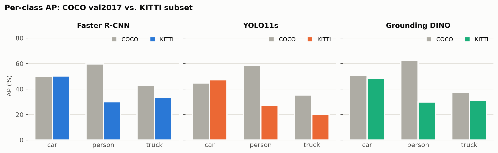
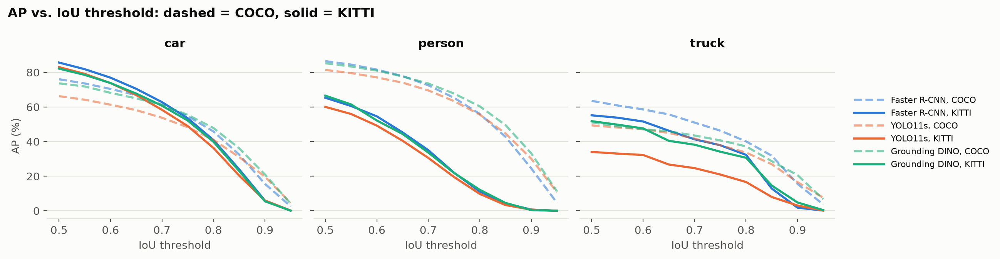
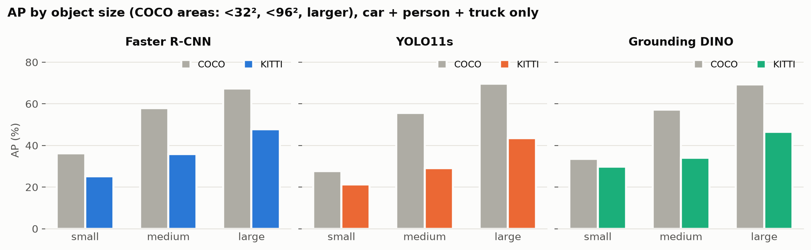
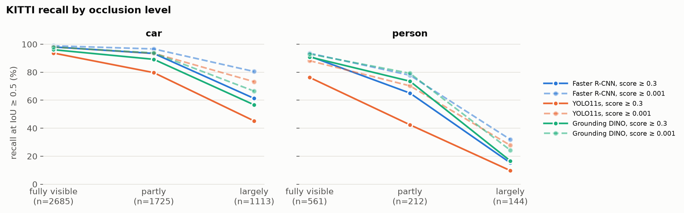

# Analysis 1: Cross-dataset generalization (COCO → KITTI)

All numbers come from `results/*/metrics.json`, `results/*_coco/metrics_shared3.json` and
`results/analysis/generalization.json`. To regenerate them, run
`python -m src.analysis.generalization`, then `python -m src.analysis.plots`.
No model was retrained. KITTI uses the default label policy (Van, Cyclist, Tram, Misc and DontCare are
ignore regions) unless stated otherwise. AP is in %.

## 1. Overall drop on the shared classes

COCO is re-evaluated on car, person and truck only (`catIds = [1, 3, 8]`), so both datasets cover the same classes.

| model | AP COCO (3 cls) | AP KITTI | drop | rel. drop |
|---|---|---|---|---|
| Faster R-CNN | 50.8 | 37.8 | 12.9 | 26% |
| YOLO11s | 46.3 | 31.4 | 14.9 | 32% |
| Grounding DINO tiny | 49.9 | 36.5 | 13.5 | 27% |

Full table: [tables/generalization_size.md](tables/generalization_size.md).

## 2. Per class: car transfers, person does not

| model | car COCO → KITTI | person COCO → KITTI | truck COCO → KITTI |
|---|---|---|---|
| Faster R-CNN | 49.9 → 50.2 (+0.3) | 59.6 → 29.9 (−29.7, −50%) | 42.7 → 33.3 (−9.4) |
| YOLO11s | 44.8 → 47.3 (+2.5) | 58.6 → 27.0 (−31.7, −54%) | 35.4 → 20.0 (−15.4) |
| Grounding DINO tiny | 50.4 → 48.4 (−2.1) | 62.3 → 29.7 (−32.6, −52%) | 37.0 → 31.3 (−5.8) |

KITTI has only 199 truck GT boxes against 5,687 car and 936 person boxes, so truck AP is the least reliable.
Full table: [tables/per_class_kitti.md](tables/per_class_kitti.md).

## 3. Where the person AP goes: localization at high IoU

| model | person AP50 COCO → KITTI | person AP75 COCO → KITTI | car AP50 COCO → KITTI | car AP75 COCO → KITTI |
|---|---|---|---|---|
| Faster R-CNN | 86.5 → 65.3 | 65.3 → 22.0 | 76.0 → 85.6 | 54.7 → 53.5 |
| YOLO11s | 81.4 → 60.0 | 63.4 → 19.6 | 66.2 → 83.0 | 48.3 → 49.0 |
| Grounding DINO tiny | 85.3 → 66.5 | 67.8 → 21.9 | 73.6 → 82.1 | 55.5 → 52.2 |

For person, the gap between datasets grows with the IoU threshold. At IoU 0.5 the drop is about a quarter.
At 0.75 it is about two thirds, and above about 0.85 KITTI person AP is close to 0. Car AP is higher on KITTI
at loose IoU and about the same at 0.75. Recall supports the same reading: at IoU ≥ 0.5 the models still find
74–80% of KITTI pedestrians when every detection is kept. Median KITTI pedestrian height is 97 px, so most
pedestrians are not small objects.

## 4. Object size

| model | APs COCO → KITTI | APm COCO → KITTI | APl COCO → KITTI |
|---|---|---|---|
| Faster R-CNN | 36.3 → 25.2 | 57.9 → 35.9 | 67.4 → 47.8 |
| YOLO11s | 27.7 → 21.3 | 55.6 → 29.1 | 69.6 → 43.5 |
| Grounding DINO tiny | 33.5 → 29.8 | 57.1 → 34.0 | 69.3 → 46.6 |

AP drops at every size. The drop is largest for medium and large objects, not for small ones.
Grounding DINO loses the least on small objects (−3.7, against −11.1 for Faster R-CNN and −6.4 for YOLO11s).

## 5. Occlusion and truncation (KITTI recall at IoU ≥ 0.5)

The matcher is greedy: detections are taken in descending score order, and each one claims the unmatched
same-class GT box with the highest IoU, if that IoU is ≥ 0.5. It reports recall at score ≥ 0.3 (the
visualization threshold) and at score ≥ 0.001 (every detection kept for mAP).

| model | class | fully visible | partly occluded | largely occluded |
|---|---|---|---|---|
| Faster R-CNN, score ≥ 0.3 | car / person | 98.1 / 91.4 | 93.4 / 65.1 | 61.3 / 15.3 |
| YOLO11s, score ≥ 0.3 | car / person | 93.7 / 76.3 | 79.7 / 42.5 | 45.2 / 9.7 |
| Grounding DINO tiny, score ≥ 0.3 | car / person | 96.1 / 90.9 | 89.2 / 73.6 | 56.7 / 16.7 |
| YOLO11s, score ≥ 0.001 | car / person | 98.0 / 88.2 | 93.5 / 70.3 | 73.2 / 27.8 |

The groups contain 2,685 / 1,725 / 1,113 car boxes and 561 / 212 / 144 person boxes. For cars, median box
height barely changes with occlusion (49 / 43 / 45 px), so the car trend is not a size effect in disguise.
For persons, height does fall (107 / 92 / 78 px), so occlusion and size are partly mixed. On truncation,
heavily truncated persons (truncation > 0.5) are found only 37–47% of the time even at score ≥ 0.001, but
that group has just 19 boxes. Full tables: [tables/generalization_occlusion.md](tables/generalization_occlusion.md).

## 6. Label-policy sensitivity (same predictions, different GT)

| model | AP, default | Van: car (Δ car / Δ truck) | Cyclist: person (Δ person) |
|---|---|---|---|
| Faster R-CNN | 37.8 | 33.4 (−1.8 / −11.2) | 35.5 (−6.8) |
| YOLO11s | 31.4 | 27.7 (−1.7 / −9.4) | 29.5 (−5.8) |
| Grounding DINO tiny | 36.5 | 32.0 (−2.8 / −10.7) | 33.8 (−7.8) |

Making Van a car class lowers car AP only a little, but truck AP falls by about 10 points. While vans are
ignore regions, a "truck" prediction on a van is neutral. Under Van: car it becomes a truck false positive.
Making Cyclist a person class also lowers person AP. Full table:
[tables/generalization_label_policy.md](tables/generalization_label_policy.md).

## Observations (hypotheses to verify, not conclusions)

- **H1, person boxes follow a different convention.** The person drop is mostly lost at high IoU, while recall
  at IoU 0.5 stays high. This fits a systematic difference in how KITTI and COCO draw pedestrian boxes (box
  extent, aspect ratio, limbs), more than a failure to detect people. *To verify:* overlay predictions on
  KITTI GT for fully visible pedestrians, and compare box aspect ratios and offsets (e.g. the median of
  (pred − GT) for each box edge). TODO(user)
- **H2, cars are already "in distribution".** Street-scene cars are common in COCO, and KITTI cars are
  mostly seen from familiar viewpoints, so car AP transfers almost unchanged and is even higher at IoU 0.5.
  TODO(user): check whether the higher car AP50 on KITTI comes from fewer hard negatives or from the
  DontCare/Van ignore regions absorbing would-be false positives.
- **H3, vans are ambiguous for COCO-trained models.** COCO has no van class. The Van: car result suggests
  the models often call vans "truck", so the KITTI score depends noticeably on the label policy. That is
  why the policy belongs in the method section. TODO(user)
- **H4, occlusion hurts recall most, and YOLO11s is least confident on occluded objects.** At score ≥ 0.3,
  YOLO11s finds 42.5% of partly occluded pedestrians. Keeping every detection raises that to 70.3%, a gap of
  about 28 points against about 13 for Faster R-CNN (65.1 → 77.8) and 6 for Grounding DINO (73.6 → 79.2). This suggests lower confidence scores
  on occluded objects (a calibration effect) rather than outright misses. TODO(user)
- **H5, Grounding DINO is the most robust on small objects.** Its APs drops least (−3.7). Possible reasons
  are its multi-scale deformable attention or its 800 px input; Faster R-CNN also uses 800 px yet drops more.
  TODO(user)
