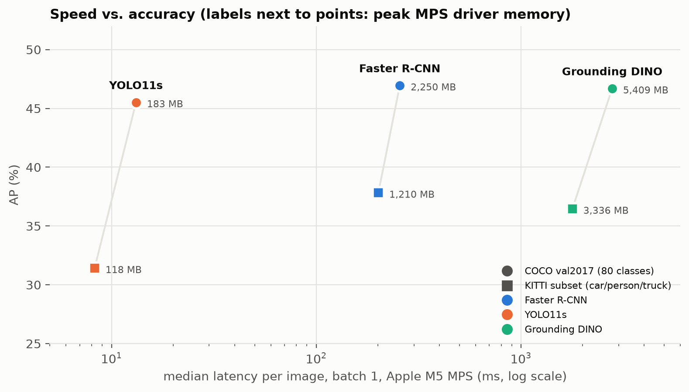
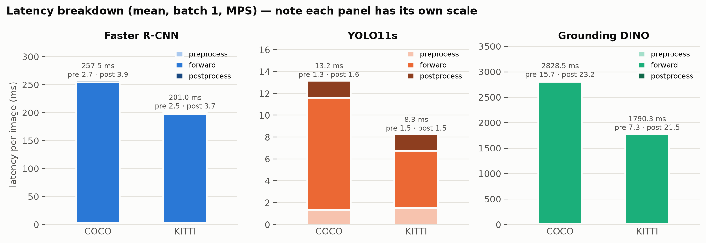

# Analysis 2: Speed–accuracy tradeoff

AP comes from M4 (`results/<model>_<dataset>/metrics.json`). Latency, FPS and memory come from the
M5 benchmark (`results/benchmark/*/benchmark.json`): batch 1 on an Apple M5 via MPS, 200 timed images
after 20 warm-up images. Input sizes and parameter counts are from `python -m src.analysis.speed_accuracy`.
Full table: [tables/speed_accuracy.md](tables/speed_accuracy.md); per-stage numbers:
[tables/speed.md](tables/speed.md).

| model | params | COCO AP | COCO latency (median) | KITTI AP | KITTI latency (median) | peak driver memory (COCO) |
|---|---|---|---|---|---|---|
| YOLO11s | 9.5 M | 45.5 | 13.2 ms (76 FPS) | 31.4 | 8.3 ms (121 FPS) | 183 MB |
| Faster R-CNN R50-FPN v2 | 43.7 M | 46.9 | 255.9 ms (3.9 FPS) | 37.8 | 201.0 ms (5.0 FPS) | 2,250 MB |
| Grounding DINO tiny | 172.3 M | 46.7 | 2,786.6 ms (0.4 FPS) | 36.5 | 1,781.7 ms (0.6 FPS) | 5,409 MB |

## 1. The tradeoff

- **On COCO the three models are within 1.4 AP of each other**, but their latencies differ by more than
  200×. Faster R-CNN buys +1.4 AP over YOLO11s at about 19× the latency. Grounding DINO is about 11× slower
  than Faster R-CNN and 0.2 AP lower.
- **On KITTI the accuracy gap opens.** YOLO11s is 6.4 AP behind Faster R-CNN, against 1.4 on COCO. So the
  cheap model's accuracy cost depends on the dataset.
- **Pareto front:** on both datasets YOLO11s and Faster R-CNN are each "best for their latency". Grounding
  DINO is dominated by Faster R-CNN (slower and slightly lower AP) when the task is the fixed 80 COCO
  classes. Its advantage, free-text classes, is not measured here; see Analysis 3.
- **Memory follows the same order:** 183 MB, 2.2 GB and 5.4 GB of peak MPS driver memory on COCO.
  Apple Silicon memory is unified (shared with the CPU), so these are not CUDA VRAM figures.

## 2. Where the time goes

| model | dataset | preprocess | forward | postprocess | forward share |
|---|---|---|---|---|---|
| Faster R-CNN | COCO / KITTI | 2.7 / 2.5 ms | 250.9 / 194.9 ms | 3.9 / 3.7 ms | 97% / 97% |
| YOLO11s | COCO / KITTI | 1.3 / 1.5 ms | 10.3 / 5.2 ms | 1.6 / 1.5 ms | 78% / 63% |
| Grounding DINO | COCO / KITTI | 15.7 / 7.3 ms | 2,789.6 / 1,761.4 ms | 23.2 / 21.5 ms | 99% / 98% |

- **Pre- and postprocessing matter only for YOLO11s.** They are 22% of its time on COCO and 37% on KITTI.
  For the two large models the forward pass is 97–99% of the time.
- **Postprocessing is measured at the mAP setting** (score threshold 0.001, 100 detections). NMS has more
  boxes to sort at this threshold than at a deployment threshold such as 0.3, so these postprocess times
  are an upper bound.
- **Where NMS sits differs by model.** For Faster R-CNN, the final class-wise NMS is in postprocessing, but
  the RPN's proposal NMS is inside the forward pass. For YOLO11s, all NMS is in postprocessing. Grounding
  DINO has no NMS within one prompt; its postprocessing includes the class-wise NMS that merges the 4
  prompt chunks.

## 3. The cost of open-vocabulary flexibility (Grounding DINO)

- **The 80 COCO class names are split into 4 prompts of 20 names**, so every image runs 4 full forward
  passes, image backbone included.
- **The text encoder itself is cheap.** BERT alone takes about 33 ms per image for all 4 prompts, which is
  1.2% (COCO) and 1.9% (KITTI) of the forward time.
- **The model is large:** 172 M parameters, against 44 M for Faster R-CNN and 9.5 M for YOLO11s.

## 4. Input resolution: Faster R-CNN's 800 px resize vs. YOLO's 640 letterbox

| model | COCO: original → network input | KITTI: original → network input |
|---|---|---|
| Faster R-CNN | 0.28 → 0.91 Mpx (typically 1216×800), ×3.2 | 0.46 → 0.56 Mpx (1344×416), ×1.2 |
| Grounding DINO | 0.28 → 0.89 Mpx (1066×800), ×3.2 | 0.46 → 0.54 Mpx (1333×402), ×1.2 |
| YOLO11s | 0.28 → 0.30 Mpx (640×448), ×1.1 | 0.46 → 0.14 Mpx (640×224), ×0.3 |

(Input size includes padding. Faster R-CNN pads to a multiple of 32.)

- **Faster R-CNN and Grounding DINO enlarge COCO images about 3×**, scaling the short side to 800 px.
  YOLO11s works near the original resolution.
- **On wide KITTI frames, YOLO11s shrinks the image** to 640×224, about a third of the original pixels. The
  other two models keep slightly more pixels than the original, because their 1333 px long-side cap is hit
  first.
- **All three models are faster on KITTI** than on COCO, and each sees fewer input pixels on KITTI.
  YOLO11s's forward time tracks its input pixels closely: 34 ms per input Mpx on COCO and 36 on KITTI.

## Observations (hypotheses to verify, not conclusions)

- **H1, YOLO11s loses more on KITTI partly because of downscaling.** At 640×224, a 40 px-tall KITTI car
  becomes about 21 px tall, while Faster R-CNN sees it slightly enlarged. This would fit YOLO11s having the
  largest KITTI drop (−14.9 AP on the shared classes vs. −12.9 for Faster R-CNN) and the lowest KITTI recall.
  *To verify:* re-run YOLO11s on KITTI with `imgsz=1280` (only a config change) and compare AP and latency.
  TODO(user)
- **H2, Grounding DINO's latency is mostly a prompt-chunking cost.** The text encoder is about 1–2% of
  the time, while the image backbone and decoder run 4 times. A single 80-class prompt (about 195 tokens,
  under the 256-token limit) might cut latency by up to about 4×, and could change AP. *To verify:* set
  `chunk_size: 80` in `configs/models.yaml` and re-run the `--limit 200` evaluation and the benchmark.
  TODO(user)
- **H3, Faster R-CNN's accuracy edge comes at a large cost in input pixels.** It processes about 3× the
  pixels of YOLO11s on COCO for +1.4 AP. The effect of its 800 px resize could be separated by evaluating
  it at a 640 px short side (`min_size=640`). TODO(user)
- **H4, the ranking may differ on other hardware.** MPS timings are not comparable to CUDA. Kernel support
  and the first-time compilation cost for each new input shape on MPS (see
  [tables/speed.md](tables/speed.md)) could change the ratios between models on a CUDA GPU. TODO(user)
- TODO(user): which model you would choose for a real-time driving use case, and why.
