# Failure cases (KITTI subset)

Counts: [tables/failure_counts.md](tables/failure_counts.md). Images: `report/figures/failures/`. Legend: green = GT, gray dashed = ignore region (KITTI type written on it), blue = correct detection, red = false positive or duplicate, light blue dashed = detection inside an ignore region (neutral), thick box = the case described. Detections shown at score >= 0.3. Generated by `python -m src.analysis.failures`.

Each hypothesis is a first guess for you to check and rewrite. TODO(user) marks where your explanation is needed.

## Summary of the counts

- **Faster R-CNN R50-FPN v2:** 961 of 6822 GT boxes missed (768 of them occluded, 135 small); 5538 FPs (3487 above 0.5): 63% background, 34% localization, 3% wrong class; 6189 detections absorbed by ignore regions (4598 DontCare, 960 Van, 432 Cyclist).
- **YOLO11s:** 1715 of 6822 GT boxes missed (1266 of them occluded, 484 small); 1008 FPs (366 above 0.5): 33% background, 62% localization, 4% wrong class; 1544 detections absorbed by ignore regions (844 DontCare, 462 Van, 172 Cyclist).
- **Grounding DINO tiny:** 1127 of 6822 GT boxes missed (872 of them occluded, 162 small); 3264 FPs (564 above 0.5): 62% background, 35% localization, 3% wrong class; 4026 detections absorbed by ignore regions (2989 DontCare, 570 Van, 320 Cyclist).
- **Cyclists (80-class re-run):** Faster R-CNN R50-FPN v2 puts both a person and a bicycle on 146 of 306; YOLO11s puts both a person and a bicycle on 67 of 306; Grounding DINO tiny puts both a person and a bicycle on 208 of 306.
- TODO(user): Faster R-CNN's FP count at score >= 0.3 is about 5x YOLO11s's, while its KITTI AP is only 6.4 points higher. Is that a calibration difference (score scale), and does it matter for your use case?

## 01. High-confidence FP (background): Faster R-CNN R50-FPN v2, frame 001755

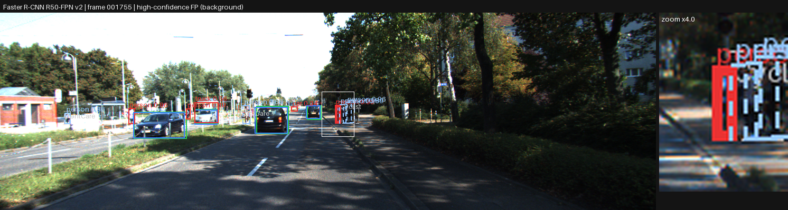

- **What went wrong:** Faster R-CNN R50-FPN v2 predicts person at 0.99; the other models have no such box.
- **Observed in the image:** The 0.99 'person' sits right beside a KITTI Cyclist ignore region and appears to be part of that cyclist, but less than half of the box lies inside the region, so it counts as an FP.
- **Hypothesis:** Unlabelled object or clutter; possibly a real object without a KITTI label. TODO(user)

## 02. High-confidence FP (background): YOLO11s, frame 004610

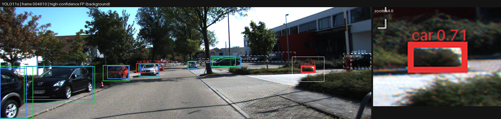

- **What went wrong:** YOLO11s predicts car at 0.71; the other models have no such box.
- **Hypothesis:** Unlabelled object or clutter; possibly a real object without a KITTI label. TODO(user)

## 03. High-confidence FP (background): Grounding DINO tiny, frame 005104

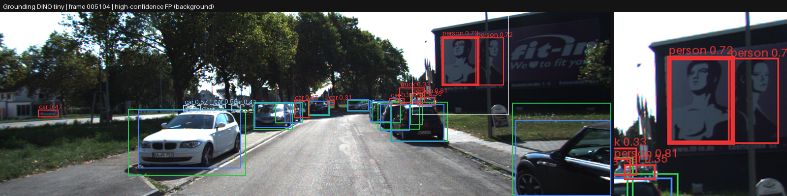

- **What went wrong:** Grounding DINO tiny predicts person at 0.72; the other models have no such box.
- **Hypothesis:** Unlabelled object or clutter; possibly a real object without a KITTI label. TODO(user)

## 04. Missed object: Faster R-CNN R50-FPN v2, frame 005306

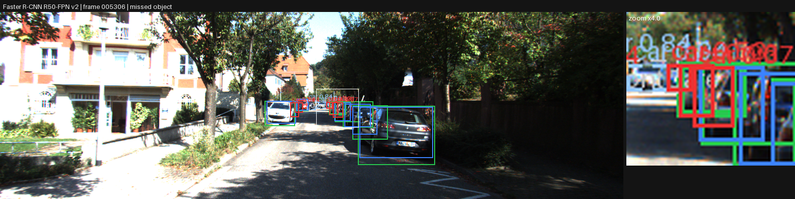

- **What went wrong:** Faster R-CNN R50-FPN v2 misses a car (28 px tall, largely occluded, truncation 0.00) that the other two find.
- **Hypothesis:** Hard instance (28 px tall, largely occluded, truncation 0.00); the other models found it, so the cue is visible. If occluded, the GT box may span the hidden part too, so a visible-part box falls below IoU 0.5. TODO(user)

## 05. Missed object: YOLO11s, frame 006139

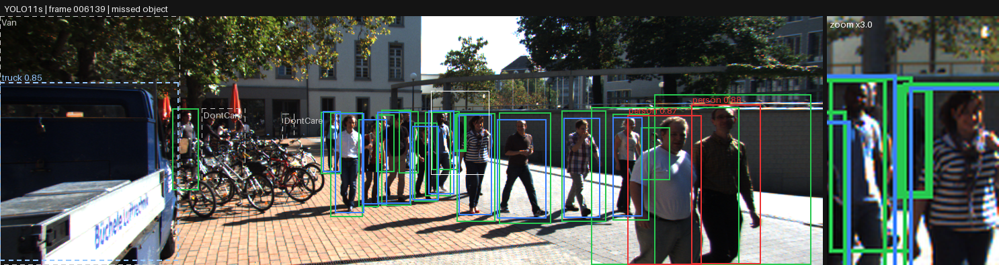

- **What went wrong:** YOLO11s misses a person (57 px tall, partly occluded, truncation 0.00) that the other two find.
- **Observed in the image:** Also visible: the two nearest pedestrians on the right have GT boxes much wider than the people, while the detections fit the people tightly (the M6 person-localization effect).
- **Hypothesis:** Hard instance (57 px tall, partly occluded, truncation 0.00); the other models found it, so the cue is visible. If occluded, the GT box may span the hidden part too, so a visible-part box falls below IoU 0.5. TODO(user)

## 06. Missed object: Grounding DINO tiny, frame 002418

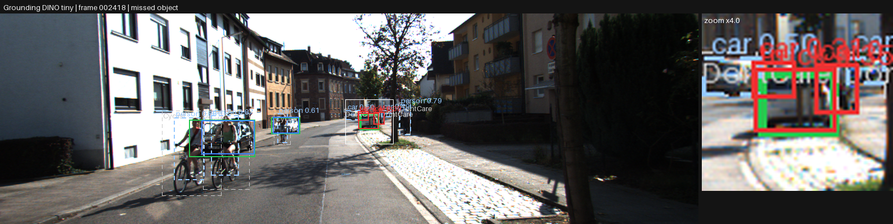

- **What went wrong:** Grounding DINO tiny misses a car (29 px tall, partly occluded, truncation 0.00) that the other two find.
- **Hypothesis:** Hard instance (29 px tall, partly occluded, truncation 0.00); the other models found it, so the cue is visible. If occluded, the GT box may span the hidden part too, so a visible-part box falls below IoU 0.5. TODO(user)

## 07. Duplicate detections: YOLO11s, frame 006689

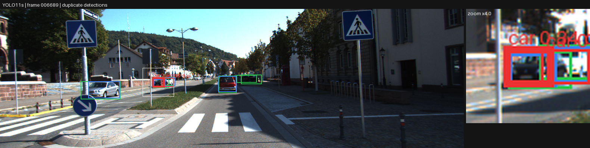

- **What went wrong:** YOLO11s: 2 duplicate boxes (score >= 0.3) on already-matched objects.
- **Observed in the image:** The duplicate is one YOLO11s box spanning two adjacent distant cars.
- **Hypothesis:** Two boxes on one object survive NMS (NMS IoU 0.7 is permissive). TODO(user)

## 08. Duplicate detections: YOLO11s, frame 006431

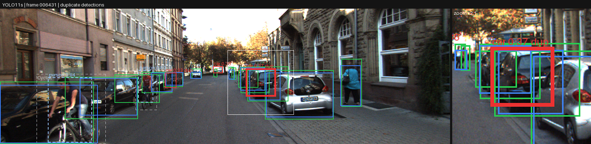

- **What went wrong:** YOLO11s: 2 duplicate boxes (score >= 0.3) on already-matched objects.
- **Hypothesis:** Two boxes on one object survive NMS (NMS IoU 0.7 is permissive). TODO(user)

## 09. Mapping: detection on a Van: Faster R-CNN R50-FPN v2, frame 001045

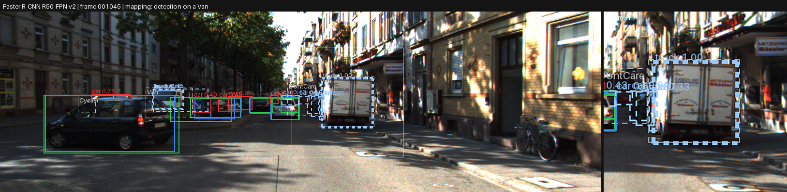

- **What went wrong:** Faster R-CNN R50-FPN v2 calls a KITTI Van 'truck' (1.00); neutral because Van is an ignore region.
- **Observed in the image:** KITTI labels this box truck as Van; COCO's 'truck' is arguably the better name for it.
- **Hypothesis:** COCO has no van class, so the model calls a van 'truck'. Neutral under Van: ignore, an FP under Van: car. TODO(user)

## 10. Mapping: cyclist: Faster R-CNN R50-FPN v2, frame 006894

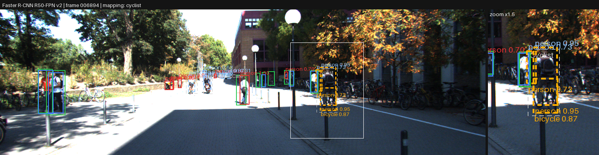

- **What went wrong:** Faster R-CNN R50-FPN v2 reports a 'person' and a 'bicycle' where KITTI has one Cyclist box (orange dashed: 80-class output on that cyclist).
- **Hypothesis:** COCO splits a cyclist into a person and a bicycle; KITTI labels one Cyclist box, so neither matches. TODO(user)

## 11. Side by side: all models, frame 000112

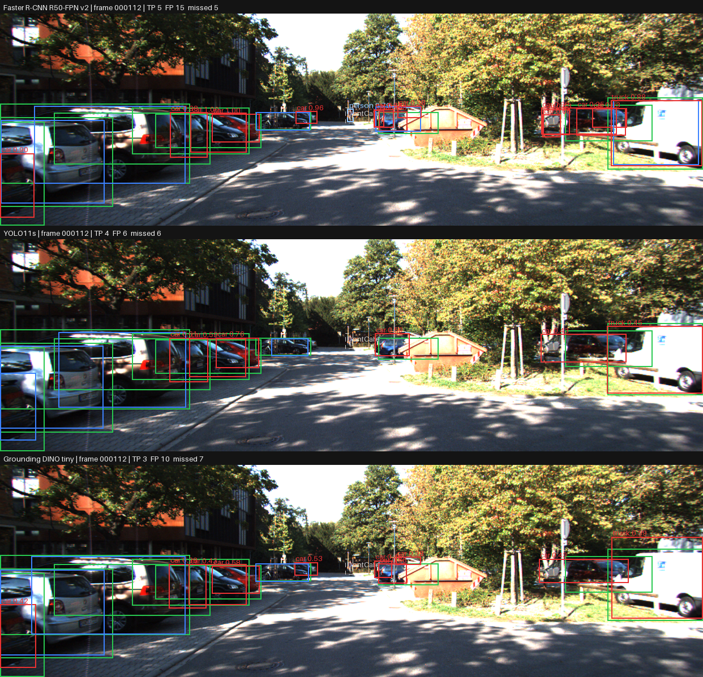

- **What went wrong:** Faster R-CNN R50-FPN v2 TP 5 / FP 15 / missed 5; YOLO11s TP 4 / FP 6 / missed 6; Grounding DINO tiny TP 3 / FP 10 / missed 7.
- **Observed in the image:** Parked cars with occlusion level 2: their KITTI boxes span the full car behind the cars in front, while the detectors box the visible part, giving IoU < 0.5 (red) plus a missed GT (green). The white van on the right is labelled Car in this frame.
- **Hypothesis:** TODO(user): what the models disagree on in this frame. TODO(user)

## 12. Side by side: all models, frame 004740

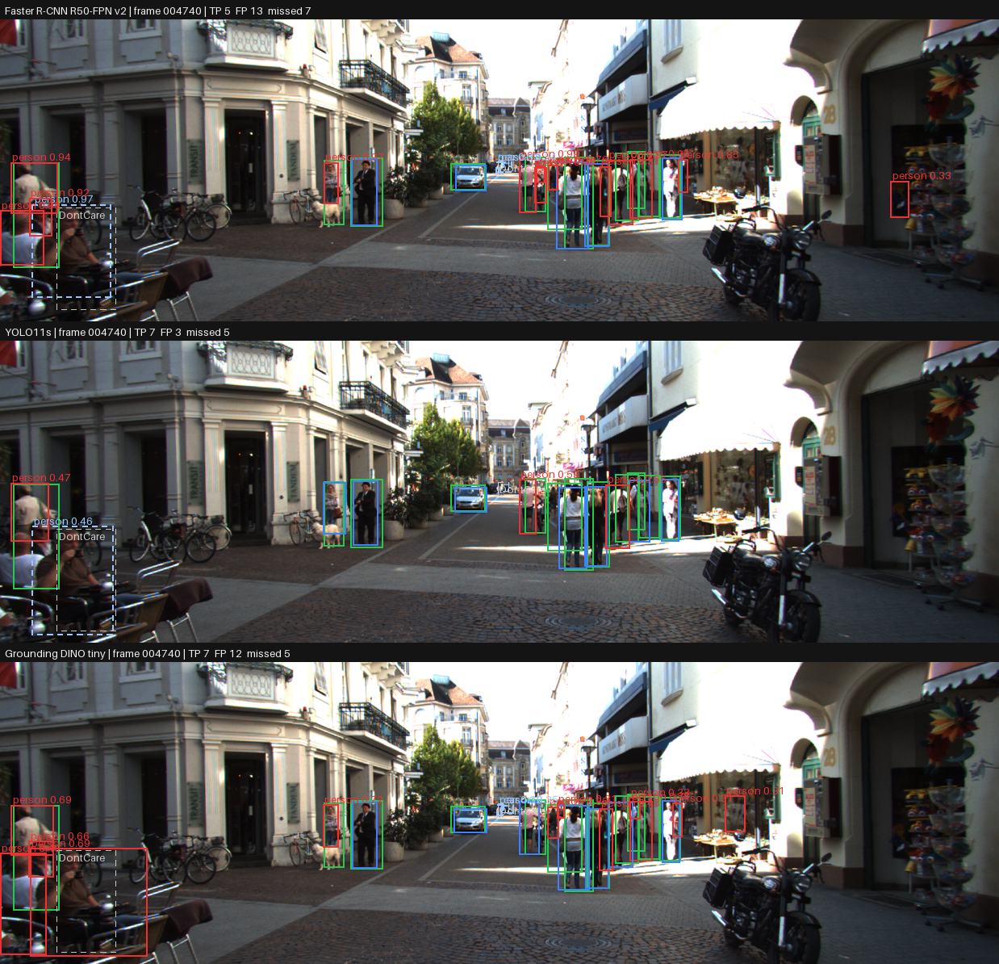

- **What went wrong:** Faster R-CNN R50-FPN v2 TP 5 / FP 13 / missed 7; YOLO11s TP 7 / FP 3 / missed 5; Grounding DINO tiny TP 7 / FP 12 / missed 5.
- **Hypothesis:** TODO(user): what the models disagree on in this frame. TODO(user)

## 13. Side by side: all models, frame 006475

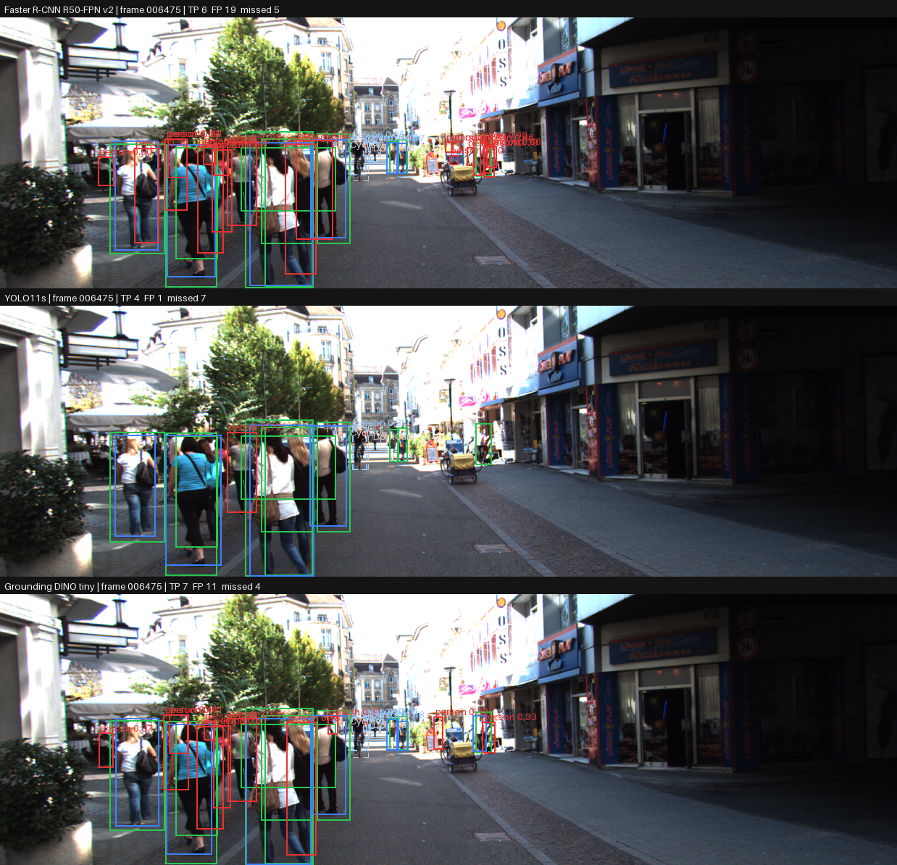

- **What went wrong:** Faster R-CNN R50-FPN v2 TP 6 / FP 19 / missed 5; YOLO11s TP 4 / FP 1 / missed 7; Grounding DINO tiny TP 7 / FP 11 / missed 4.
- **Hypothesis:** TODO(user): what the models disagree on in this frame. TODO(user)
