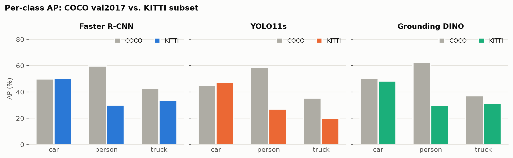
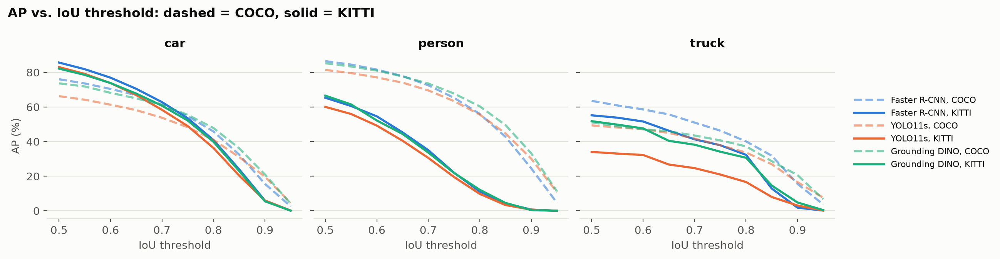
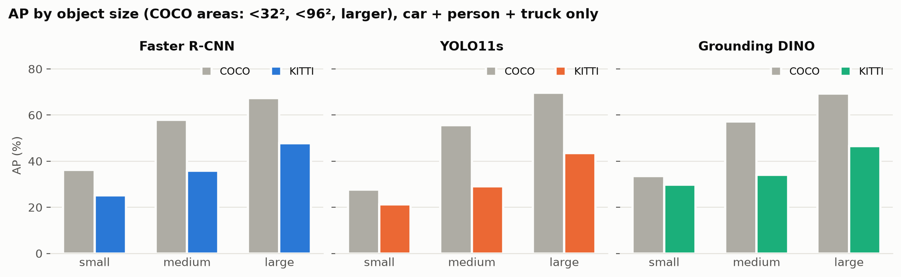
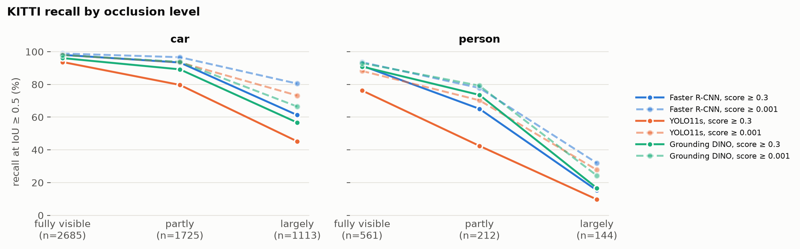
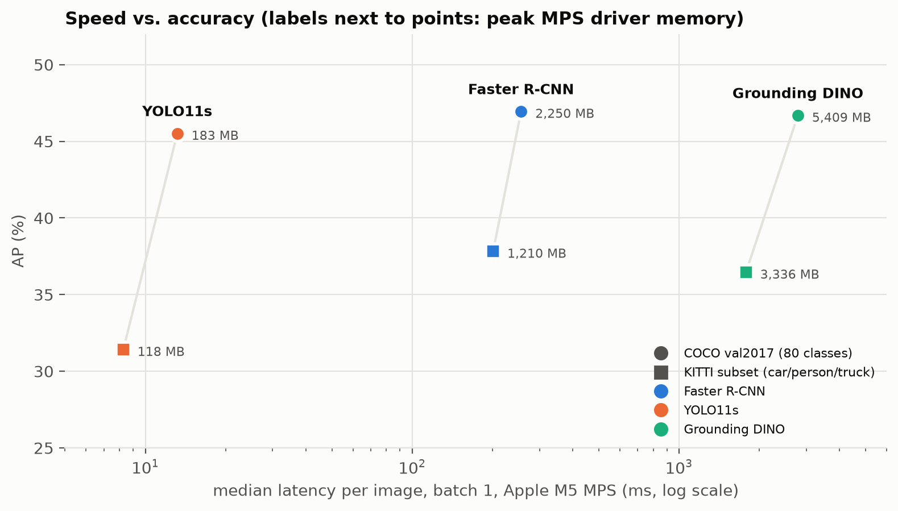
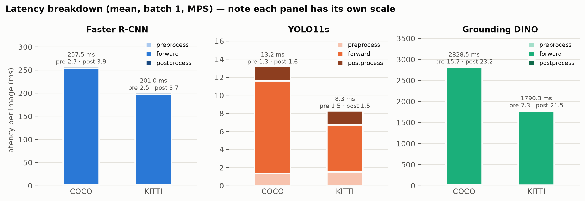
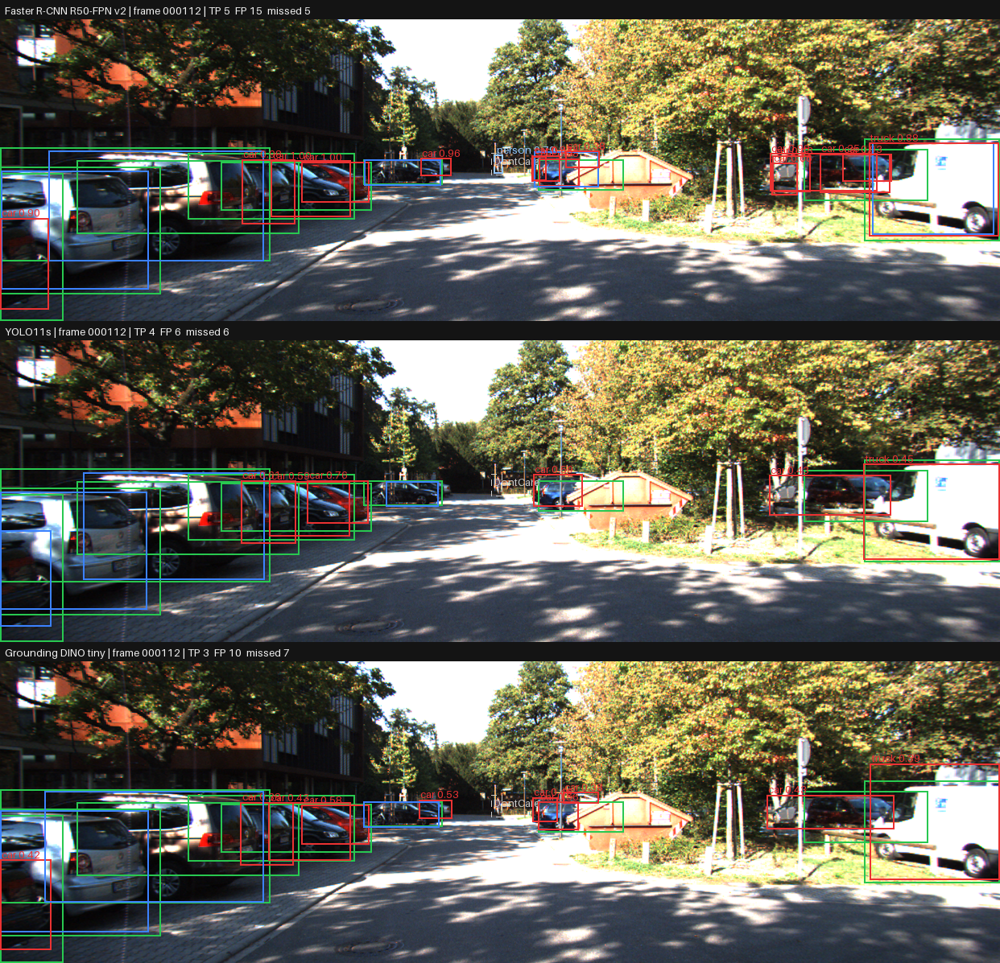
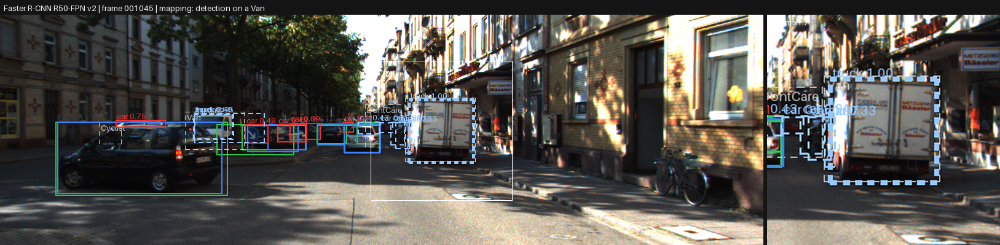
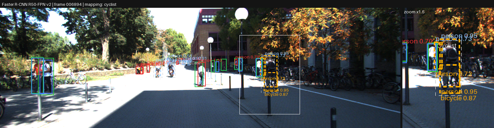
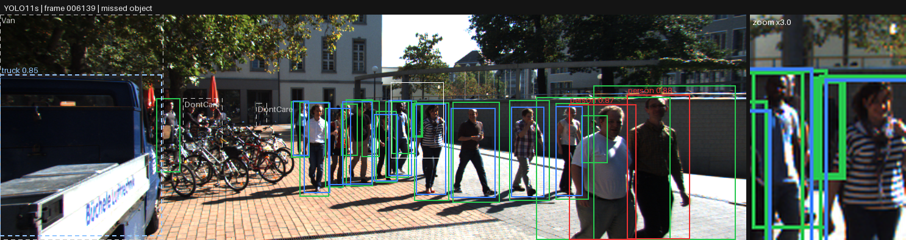

<!-- Generated from report_template.md by `python -m src.analysis.build_report`. Edit the template, not this file. -->

# From COCO to KITTI Without Fine-Tuning: Accuracy, Speed, and Vocabulary of Three Object Detector Families

TODO(user): author, course (CMPE 249, Intelligent Autonomous Systems), date.

> **How to use this draft.** It is a skeleton. Tables and figures are filled in from the generated
> results; the prose marked `TODO(user)` is yours to write. Edit `report/report_template.md` and run
> `python -m src.analysis.build_report` to regenerate `report/report_draft.md`. Every number in a table
> comes from a `metrics.json` or `benchmark.json` under `results/` (via `report/tables/`). Target length
> is 6–10 pages as PDF, so not every table below needs to stay. Move the detailed ones to an appendix.

## 1. Introduction: Do Detectors Trained on Everyday Photos Work on a Driving Benchmark?

TODO(user): motivation, 1 paragraph. Why an autonomous system would reuse a pretrained detector instead
of training its own, and why that is risky. Keep the first and last sentence of each paragraph your own
claim, and put citations in the middle sentences (IEEE style, e.g. [1], [2]).

Objectives of this study:

1. Evaluate three pretrained detectors from three design families on the Common Objects in Context
   (COCO) validation set and on a subset of the KITTI (Karlsruhe Institute of Technology and Toyota
   Technological Institute) driving benchmark, without any retraining.
2. Measure how much accuracy each detector loses when moving from COCO to KITTI, and why
   (classes, object size, occlusion, label policy).
3. Measure the speed–accuracy tradeoff on one consumer device (Apple M5) with its graphics processing
   unit (GPU).
4. (Bonus) Test whether an open-vocabulary detector can use KITTI's own class names to close part of
   the gap, and what it can detect that the closed-set models cannot.

TODO(user): one sentence on the paper's structure (sections 2–11).

## 2. Three Detector Families and Two Benchmarks

### 2.1 Detectors

The three detectors are Faster R-CNN (region-based convolutional neural network), YOLO11s (You Only
Look Once, version 11, small) and Grounding DINO tiny (DINO: DETR with improved denoising anchor boxes).

| | Faster R-CNN R50-FPN v2 | YOLO11s | Grounding DINO tiny |
|---|---|---|---|
| Family | two-stage, anchor-based | one-stage, anchor-free | open-vocabulary, query-based transformer |
| Checkpoint | torchvision `fasterrcnn_resnet50_fpn_v2`, `COCO_V1` | Ultralytics `yolo11s.pt` | Hugging Face `IDEA-Research/grounding-dino-tiny` |
| Parameters | 43.7 M | 9.5 M | 172.3 M |
| Input (this study) | short side 800, long side ≤ 1333 | long side 640, letterboxed | short side 800, long side ≤ 1333 |
| Classes | 80 COCO (fixed) | 80 COCO (fixed) | any text prompt |

Parameter counts were measured on the loaded models (`results/analysis/speed_accuracy.json`).

TODO(user): rewrite these three method summaries in your own words; they are placeholders.

The two-stage detector separates *where* from *what*. A region proposal network (RPN) scores
preset anchor boxes on a ResNet-50 feature pyramid network (FPN) and keeps about a thousand candidate
regions, which a second head then classifies and refines [3], [4]. The torchvision v2 weights use an
improved training recipe for the same architecture [5], [11]. Proposal quality is therefore the
first thing a domain shift can break.

The one-stage detector predicts boxes and class scores for every grid cell in a single pass, with no
proposal step. Modern YOLO variants are anchor-free and regress the distances to the four box edges
directly [6], [7]. This design trades a little accuracy for a very short pipeline.

The open-vocabulary detector receives the image and a text prompt such as `car . person . truck .`.
A Swin Transformer image backbone and a Bidirectional Encoder Representations from Transformers
(BERT) text encoder are fused, and a transformer decoder with
900 learned queries predicts boxes, each scored against every prompt word [8], [10], [14]. The checkpoint is loaded through the Hugging Face Transformers library [12], and its
detection head follows the set-prediction approach of the DEtection TRansformer (DETR) [9]. The class list is thus an input,
not a property of the weights.

### 2.2 Datasets and the KITTI label mapping

- **COCO val2017** [1]: 5,000 images, 80 classes, scored on all 80.
- **KITTI 2D object detection** [2]: a fixed random subset of 1,500 frames from the labeled training
  split (seed 42; the list is `data/kitti/subset_1500.txt`). The KITTI test labels are private.
  Scored on car, person and truck, using COCO's own category ids.

| KITTI type | Mapped to | Reason |
|---|---|---|
| Car | car | same class |
| Pedestrian, Person_sitting | person | COCO has one person class |
| Truck | truck | same class |
| Van | ignore (sensitivity test: car) | COCO has no van class; the models call vans car or truck |
| Cyclist | ignore (sensitivity test: person) | COCO splits a cyclist into person + bicycle |
| Tram, Misc, DontCare | ignore | no COCO equivalent / unlabelled regions |

An *ignore* box is written as a COCO crowd region (`iscrowd=1`). A detection inside it is neither a
true nor a false positive, and missing it costs nothing. TODO(user): justify this policy in your own
words; section 6.5 shows how much it matters.

- images: 1500
- evaluated boxes: 6822
- ignore regions (iscrowd=1, counted once each): 3363
- mapping: `{'Car': 'car', 'Pedestrian': 'person', 'Person_sitting': 'person', 'Truck': 'truck', 'Van': 'ignore', 'Cyclist': 'ignore', 'Tram': 'ignore', 'Misc': 'ignore', 'DontCare': 'ignore'}`

#### Evaluated boxes by class and COCO size (area < 32², < 96², else large)

| class | boxes | small | medium | large | from KITTI types |
|---|---|---|---|---|---|
| car | 5687 | 948 | 3046 | 1693 | Car 5687 |
| person | 936 | 209 | 475 | 252 | Pedestrian 906, Person_sitting 30 |
| truck | 199 | 31 | 117 | 51 | Truck 199 |
| **all** | 6822 | 1188 | 3638 | 1996 | |

#### Ignore regions by KITTI type

| KITTI type | regions |
|---|---|
| Cyclist | 306 |
| DontCare | 2198 |
| Misc | 196 |
| Tram | 99 |
| Van | 564 |

#### Evaluated boxes by occlusion level (0 visible, 1 partly, 2 largely, 3 unknown)

| class | occ 0 | occ 1 | occ 2 | occ 3 |
|---|---|---|---|---|
| car | 2685 | 1725 | 1113 | 164 |
| person | 561 | 212 | 144 | 19 |
| truck | 85 | 61 | 24 | 29 |

## 3. Experimental Setup on Apple Silicon

- **Hardware and software:** see the environment record below (generated by `scripts/record_env.py`).
  All models ran on the GPU through PyTorch's Metal Performance Shaders (MPS) backend, with no CPU
  fallback needed.
- **Evaluation:** one evaluator for everything, pycocotools `COCOeval` (bounding boxes) [13]. It
  reports average precision (AP) averaged over intersection over union (IoU) thresholds 0.50–0.95 (AP50 and AP75 at a single
  threshold; APs/APm/APl by object size), with
  score threshold 0.001 and at most 100 detections per image. On KITTI, every model is asked for all
  80 COCO classes, and predictions outside car/person/truck are dropped afterwards.
- **Model settings** (`configs/models.yaml`):
  - YOLO11s: non-maximum suppression (NMS) at IoU 0.7, one class per box.
  - Grounding DINO: box threshold 0.05; the 80 class names are split into 4 prompts of 20, and the
    chunks are merged with class-wise NMS at IoU 0.5. A box's class comes from its mean probability
    over the tokens of each class name.
- **Speed:** batch 1, 20 warm-up and 200 timed images (the same list for every model), repeated twice.
  Preprocessing, the forward pass and postprocessing are timed separately, with a device synchronize
  before each timestamp.

```text
python: 3.11.18
torch: 2.15.0
torchvision: 0.29.2
ultralytics: 8.4.214
transformers: 5.23.0
pycocotools: 2.0.11
numpy: 2.4.6
pillow: 13.0.0
pandas: 3.1.1
matplotlib: 3.11.2
pyyaml: 6.0.3
tqdm: 4.70.1
torch.backends.mps.is_available(): True
torch.backends.mps.is_built(): True
torch.cuda.is_available(): False
os: macOS 26.5.2 (build 25F84)
machine: arm64
chip: Apple M5
cpu_cores: 10
total_ram: 16.0 GB
```

TODO(user): note anything about the setup a reader needs in order to trust the numbers.

## 4. Commands and Configurations

Everything is reproducible from the repository (`README.md` lists the steps in order); every command
that was run is in `logs/commands.log`.

| Step | Command | Produces |
|---|---|---|
| Environment + COCO | `scripts/m0_setup.sh` | `.venv`, `env.txt`, `data/coco/` |
| KITTI ground truth | `scripts/m2_kitti.sh` | `data/kitti/annotations/kitti_subset_coco.json` |
| Pipeline check | `scripts/m3_eval.sh` | 200-image runs, YOLO cross-check |
| Full evaluation | `scripts/m4_full_runs.sh` | `results/<model>_<dataset>/metrics.json` |
| Speed benchmark | `scripts/m5_benchmark.sh` | `results/benchmark/*/benchmark.json` |
| Analyses 1–2 | `python -m src.analysis.generalization`, `speed_accuracy`, `plots` | tables, figures |
| Analysis 3 + ablations | `scripts/m8_open_vocab.sh` | open-vocabulary tables |
| Failure analysis | `python -m src.analysis.failures` | gallery, counts |
| This draft | `python -m src.analysis.build_report` | `report/report_draft.md` |

## 5. Results on COCO and KITTI

| model | dataset | images | AP | AP50 | AP75 | APs | APm | APl | AR1 | AR10 | AR100 | ARs | ARm | ARl | device | predict ms/img |
|---|---|---|---|---|---|---|---|---|---|---|---|---|---|---|---|---|
| Faster R-CNN R50-FPN v2 | COCO val2017 | 5000 | 46.9 | 67.9 | 51.4 | 30.9 | 50.8 | 60.3 | 37.0 | 59.6 | 63.0 | 47.3 | 66.5 | 77.4 | mps | 260.0 |
| Faster R-CNN R50-FPN v2 | KITTI subset | 1500 | 37.8 | 68.7 | 37.8 | 25.2 | 35.9 | 47.8 | 26.0 | 52.6 | 55.1 | 57.3 | 53.9 | 56.5 | mps | 196.5 |
| YOLO11s | COCO val2017 | 5000 | 45.5 | 62.0 | 49.2 | 27.6 | 50.1 | 62.5 | 34.7 | 56.3 | 60.2 | 40.1 | 65.9 | 76.8 | mps | 13.2 |
| YOLO11s | KITTI subset | 1500 | 31.4 | 59.0 | 29.8 | 21.3 | 29.1 | 43.5 | 21.3 | 43.1 | 45.8 | 40.4 | 44.2 | 54.0 | mps | 8.2 |
| Grounding DINO tiny | COCO val2017 | 5000 | 46.7 | 63.2 | 50.4 | 32.5 | 49.9 | 61.3 | 38.4 | 63.0 | 66.3 | 51.9 | 69.8 | 81.7 | mps | 2751.3 |
| Grounding DINO tiny | KITTI subset | 1500 | 36.5 | 66.8 | 36.1 | 29.8 | 34.0 | 46.6 | 26.0 | 52.7 | 54.3 | 59.0 | 51.8 | 57.2 | mps | 1730.4 |

AP/AR in %, from pycocotools COCOeval (bbox, maxDets=100). COCO: 80 classes; KITTI: car, person, truck with Van/Cyclist/Tram/Misc/DontCare as ignore regions. predict ms/img is the mean time of one predict() call during the evaluation run (batch 1), not the M5 benchmark.

**Sanity checks.** COCO AP is within 1.7 points of the published value for each checkpoint:

| model | our COCO AP | published AP | difference | flag (>3 AP) | source |
|---|---|---|---|---|---|
| Faster R-CNN R50-FPN v2 | 46.9 | 46.7 | +0.2 | no | torchvision weights metadata, FasterRCNN_ResNet50_FPN_V2_Weights.COCO_V1 |
| YOLO11s | 45.5 | 47.0 | -1.5 | no | Ultralytics YOLO11 docs, mAP val 50-95 at 640 |
| Grounding DINO tiny | 46.7 | 48.4 | -1.7 | no | IDEA-Research/GroundingDINO model zoo, Swin-T (O365, GoldG, Cap4M), zero-shot |

YOLO11s through our pipeline is within 0.7 AP of Ultralytics' own validator. Most of the remaining
gap to pycocotools scoring Ultralytics' predictions is the validator's multi-label NMS:

Validator settings: {'imgsz': 640, 'conf': 0.001, 'iou': 0.7, 'max_det': 100, 'batch': 1, 'device': 'mps'}

| source | AP | AP50 | AP75 | APs | APm | APl |
|---|---|---|---|---|---|---|
| A_ultralytics_metric (multi_label NMS) | 46.2 | 62.9 | - | - | - | - |
| B_pycocotools_on_ultralytics_preds (multi_label NMS) | 46.8 | 63.5 | 50.5 | 28.8 | 51.5 | 64.4 |
| A_ultralytics_metric (single_label NMS) | 45.6 | 62.1 | - | - | - | - |
| B_pycocotools_on_ultralytics_preds (single_label NMS) | 46.2 | 62.7 | 49.8 | 28.2 | 50.9 | 63.6 |
| C_our_pipeline (model.predict, single_label NMS) | 45.5 | 62.0 | 49.2 | 27.6 | 50.1 | 62.5 |

- C - A_ultralytics_metric (multi_label NMS): -0.69 AP
- C - B_pycocotools_on_ultralytics_preds (multi_label NMS): -1.25 AP
- C - A_ultralytics_metric (single_label NMS): -0.11 AP
- C - B_pycocotools_on_ultralytics_preds (single_label NMS): -0.66 AP

| model | class | AP COCO | AP KITTI | drop | rel. drop | AP50 COCO | AP50 KITTI | GT COCO | GT KITTI |
|---|---|---|---|---|---|---|---|---|---|
| Faster R-CNN R50-FPN v2 | car | 49.9 | 50.2 | -0.3 | -1% | 76.0 | 85.6 | 1918 | 5687 |
| Faster R-CNN R50-FPN v2 | person | 59.6 | 29.9 | 29.7 | 50% | 86.5 | 65.3 | 10777 | 936 |
| Faster R-CNN R50-FPN v2 | truck | 42.7 | 33.3 | 9.4 | 22% | 63.5 | 55.2 | 414 | 199 |
| YOLO11s | car | 44.8 | 47.3 | -2.5 | -6% | 66.2 | 83.0 | 1918 | 5687 |
| YOLO11s | person | 58.6 | 27.0 | 31.7 | 54% | 81.4 | 60.0 | 10777 | 936 |
| YOLO11s | truck | 35.4 | 20.0 | 15.4 | 44% | 49.4 | 34.0 | 414 | 199 |
| Grounding DINO tiny | car | 50.4 | 48.4 | 2.1 | 4% | 73.6 | 82.1 | 1918 | 5687 |
| Grounding DINO tiny | person | 62.3 | 29.7 | 32.6 | 52% | 85.3 | 66.5 | 10777 | 936 |
| Grounding DINO tiny | truck | 37.0 | 31.3 | 5.8 | 16% | 51.1 | 51.8 | 414 | 199 |

Per-class AP (%) = precision averaged over IoU 0.50:0.95 and recall, area=all, maxDets=100. drop = AP COCO - AP KITTI (AP points); rel. drop = drop / AP COCO. COCO AP here is from the 80-class evaluation; M6 re-evaluates COCO on these 3 classes only.

TODO(user): 2–3 sentences reading the main table.

## 6. Analysis 1: What Breaks When Moving from COCO to KITTI

Detailed write-up with all hypotheses: [analysis_generalization.md](analysis_generalization.md).

### 6.1 Per-class transfer



### 6.2 Localization at high IoU



### 6.3 Object size (shared classes only)

| model | AP (COCO / KITTI) | AP50 (COCO / KITTI) | APs (COCO / KITTI) | APm (COCO / KITTI) | APl (COCO / KITTI) | AP drop | rel. drop |
|---|---|---|---|---|---|---|---|
| Faster R-CNN R50-FPN v2 | 50.8 / 37.8 | 75.3 / 68.7 | 36.3 / 25.2 | 57.9 / 35.9 | 67.4 / 47.8 | 12.9 | 26% |
| YOLO11s | 46.3 / 31.4 | 65.7 / 59.0 | 27.7 / 21.3 | 55.6 / 29.1 | 69.6 / 43.5 | 14.9 | 32% |
| Grounding DINO tiny | 49.9 / 36.5 | 70.0 / 66.8 | 33.5 / 29.8 | 57.1 / 34.0 | 69.3 / 46.6 | 13.5 | 27% |

COCO is re-evaluated with catIds = [1, 3, 8] so both columns cover the same 3 classes. Size buckets are COCO's (area < 32², < 96², else large). AP in %.



### 6.4 Occlusion and truncation



Greedy score-sorted matching per image and class; a GT box counts as found if a same-class detection with score >= threshold overlaps it at IoU >= 0.5 and was not already used. Recall in %.

| model | score >= | class | occ 0 fully visible | occ 1 partly occluded | occ 2 largely occluded | occ 3 unknown | trunc 0-0.15 | trunc 0.15-0.3 | trunc 0.3-0.5 | trunc >0.5 | all |
|---|---|---|---|---|---|---|---|---|---|---|---|
| Faster R-CNN R50-FPN v2 | 0.001 | car | 98.9 | 96.6 | 80.5 | 86.6 | 94.3 | 96.7 | 92.5 | 93.3 | 94.3 |
| Faster R-CNN R50-FPN v2 | 0.001 | person | 93.6 | 77.8 | 31.9 | 63.2 | 81.2 | 72.7 | 66.7 | 36.8 | 79.9 |
| Faster R-CNN R50-FPN v2 | 0.3 | car | 98.1 | 93.4 | 61.3 | 73.8 | 89.0 | 92.4 | 87.7 | 85.4 | 88.7 |
| Faster R-CNN R50-FPN v2 | 0.3 | person | 91.4 | 65.1 | 15.3 | 52.6 | 74.3 | 63.6 | 50.0 | 36.8 | 73.0 |
| YOLO11s | 0.001 | car | 98.0 | 93.5 | 73.2 | 84.8 | 91.5 | 98.9 | 93.4 | 88.3 | 91.4 |
| YOLO11s | 0.001 | person | 88.2 | 70.3 | 27.8 | 68.4 | 75.4 | 77.3 | 58.3 | 36.8 | 74.5 |
| YOLO11s | 0.3 | car | 93.7 | 79.7 | 45.2 | 65.9 | 78.6 | 91.3 | 86.8 | 81.2 | 79.2 |
| YOLO11s | 0.3 | person | 76.3 | 42.5 | 9.7 | 42.1 | 58.2 | 68.2 | 33.3 | 36.8 | 57.7 |
| Grounding DINO tiny | 0.001 | car | 98.0 | 93.8 | 66.5 | 77.4 | 90.4 | 95.7 | 90.6 | 84.4 | 89.9 |
| Grounding DINO tiny | 0.001 | person | 93.0 | 79.2 | 24.3 | 63.2 | 79.8 | 68.2 | 66.7 | 47.4 | 78.7 |
| Grounding DINO tiny | 0.3 | car | 96.1 | 89.2 | 56.7 | 68.9 | 85.9 | 90.2 | 85.8 | 80.2 | 85.5 |
| Grounding DINO tiny | 0.3 | person | 90.9 | 73.6 | 16.7 | 57.9 | 75.9 | 68.2 | 66.7 | 42.1 | 74.9 |

#### GT counts and box size per group

| class |  | occ 0 fully visible | occ 1 partly occluded | occ 2 largely occluded | occ 3 unknown | trunc 0-0.15 | trunc 0.15-0.3 | trunc 0.3-0.5 | trunc >0.5 | all |
|---|---|---|---|---|---|---|---|---|---|---|
| car | GT boxes | 2685 | 1725 | 1113 | 164 | 5009 | 92 | 106 | 480 | 5687 |
| person | GT boxes | 561 | 212 | 144 | 19 | 883 | 22 | 12 | 19 | 936 |
| car | median height (px) | 49 | 43 | 45 | 119 | 43 | 136 | 161 | 168 | 47 |
| person | median height (px) | 107 | 92 | 78 | 156 | 93 | 215 | 182 | 195 | 97 |

### 6.5 Label-policy sensitivity

| model | policy | AP (3 cls) | car AP | person AP | truck AP | Δ car | Δ person | Δ truck |
|---|---|---|---|---|---|---|---|---|
| Faster R-CNN R50-FPN v2 | ignore (default) | 37.8 | 50.2 | 29.9 | 33.3 | +0.0 | +0.0 | +0.0 |
| Faster R-CNN R50-FPN v2 | Van: car | 33.4 | 48.4 | 29.9 | 22.1 | -1.8 | -0.0 | -11.3 |
| Faster R-CNN R50-FPN v2 | Cyclist: person | 35.5 | 50.2 | 23.1 | 33.3 | -0.0 | -6.8 | -0.0 |
| YOLO11s | ignore (default) | 31.4 | 47.3 | 27.0 | 20.0 | +0.0 | +0.0 | +0.0 |
| YOLO11s | Van: car | 27.7 | 45.6 | 26.9 | 10.6 | -1.7 | -0.0 | -9.3 |
| YOLO11s | Cyclist: person | 29.5 | 47.3 | 21.2 | 20.0 | -0.0 | -5.8 | +0.0 |
| Grounding DINO tiny | ignore (default) | 36.5 | 48.4 | 29.7 | 31.3 | +0.0 | +0.0 | +0.0 |
| Grounding DINO tiny | Van: car | 32.0 | 45.6 | 29.7 | 20.6 | -2.8 | -0.0 | -10.7 |
| Grounding DINO tiny | Cyclist: person | 33.8 | 48.3 | 21.9 | 31.2 | -0.0 | -7.8 | -0.0 |

GT boxes (car / person / truck): ignore (default): 5687 / 936 / 199; Van: car: 6251 / 936 / 199; Cyclist: person: 5687 / 1242 / 199. When a type stops being an ignore region, detections on it are no longer neutral for the other classes either (e.g. a 'truck' box on a van becomes a truck false positive under Van: car).

TODO(user): your interpretation. Candidate hypotheses (from `analysis_generalization.md`, not yet
verified): pedestrian box convention, cars already in distribution, van ambiguity, occlusion and
score calibration, small-object robustness of Grounding DINO.

## 7. Analysis 2: The Speed–Accuracy Tradeoff

Detailed write-up: [analysis_speed.md](analysis_speed.md).



| model | dataset | AP | latency median (ms) | FPS | peak driver mem (MB) | params (M) | typical input W×H | input Mpx (mean) | original Mpx (mean) | forward ms / input Mpx |
|---|---|---|---|---|---|---|---|---|---|---|
| Faster R-CNN R50-FPN v2 | COCO val2017 | 46.9 | 255.9 | 3.9 | 2250 | 43.7 | 1216×800 | 0.91 | 0.28 | 276 |
| Faster R-CNN R50-FPN v2 | KITTI subset | 37.8 | 201.0 | 5.0 | 1210 | 43.7 | 1344×416 | 0.56 | 0.46 | 349 |
| YOLO11s | COCO val2017 | 45.5 | 13.2 | 75.9 | 183 | 9.5 | 640×448 | 0.30 | 0.28 | 34 |
| YOLO11s | KITTI subset | 31.4 | 8.3 | 120.8 | 118 | 9.5 | 640×224 | 0.14 | 0.46 | 36 |
| Grounding DINO tiny | COCO val2017 | 46.7 | 2786.6 | 0.4 | 5409 | 172.3 | 1066×800 | 0.89 | 0.28 | 3123 |
| Grounding DINO tiny | KITTI subset | 36.5 | 1781.7 | 0.6 | 3336 | 172.3 | 1333×402 | 0.54 | 0.46 | 3285 |

AP: COCO = 80 classes, KITTI = car/person/truck (M4). Latency, FPS and memory: M5 benchmark (batch 1, MPS, last repeat). Input size is measured after each model's own resize/letterbox (padding included) on the 200 timed benchmark images. Grounding DINO's forward time covers 4 passes (one per prompt chunk), so its ms per input Mpx counts each pixel 4 times.



Latency in ms per image (stage means; total = sum of stages per image).

| model | dataset | preprocess | forward | postprocess | total mean | total median | total p90 | FPS | run diff (mean) | run diff (median) | peak MPS alloc (MB) | peak driver (MB) |
|---|---|---|---|---|---|---|---|---|---|---|---|---|
| Faster R-CNN R50-FPN v2 | COCO val2017 | 2.7 | 250.9 | 3.9 | 257.5 | 255.9 | 271.7 | 3.9 | 0.2% | 0.6% | 167 | 2250 |
| Faster R-CNN R50-FPN v2 | KITTI subset | 2.5 | 194.9 | 3.7 | 201.0 | 201.0 | 201.7 | 5.0 | 0.1% | 0.4% | 167 | 1210 |
| YOLO11s | COCO val2017 | 1.3 | 10.3 | 1.6 | 13.2 | 13.2 | 14.6 | 75.9 | 32.2% | 0.6% | 36 | 183 |
| YOLO11s | KITTI subset | 1.5 | 5.2 | 1.5 | 8.3 | 8.3 | 8.3 | 120.8 | 1.1% | 1.1% | 36 | 118 |
| Grounding DINO tiny | COCO val2017 | 15.7 | 2789.6 | 23.2 | 2828.5 | 2786.6 | 3084.2 | 0.4 | 2.4% | 0.2% | 659 | 5409 |
| Grounding DINO tiny | KITTI subset | 7.3 | 1761.4 | 21.5 | 1790.3 | 1781.7 | 1815.1 | 0.6 | 0.2% | 0.3% | 659 | 3336 |

Protocol: 20 warm-up + 200 timed images (same list for every model), 2 repeats; table shows the last repeat. run diff = (max-min)/min across repeats of the mean or median total; the median is the stability criterion (<10%), because the mean of the first repeat includes one-off MPS kernel compilation for input shapes not seen during warm-up (see below). Image decoding is not timed. Device synchronized before every timestamp. Evaluation thresholds (score 0.001, 100 dets). NMS: Faster R-CNN final NMS in postprocess (proposal NMS inside forward); YOLO11s NMS in postprocess; Grounding DINO forward = 4 prompt-chunk passes, postprocess includes the cross-chunk NMS.

Memory: peak of torch.mps.current_allocated_memory() (tensors) and driver_allocated_memory() (all Metal allocations) after each image. Apple Silicon unified memory is shared with the CPU, so this is not equivalent to CUDA VRAM.

- Grounding DINO on COCO val2017: text encoder (BERT, 4 prompt chunks) alone takes 33.2 ms/img, about 1.2% of the forward time.
- Grounding DINO on KITTI subset: text encoder (BERT, 4 prompt chunks) alone takes 33.1 ms/img, about 1.9% of the forward time.

#### First-seen input shapes on MPS

COCO images vary in size, so the network input shape varies; MPS compiles kernels the first time it sees a shape. KITTI frames all have one size. Measured after the same 20 warm-up images:

| model | dataset | distinct shapes | imgs with new shape | ms (new shape) | ms (seen shape) |
|---|---|---|---|---|---|
| YOLO11s | COCO val2017 | 18 | 10 | 140.9 | 13.5 |
| Faster R-CNN R50-FPN v2 | COCO val2017 | 26 | 17 | 281.9 | 243.1 |
| YOLO11s | KITTI subset | 1 | 0 | - | 8.5 |
| Faster R-CNN R50-FPN v2 | KITTI subset | 1 | 0 | - | 201.0 |

### 7.1 Ablations: input size and prompt chunking

The main tables keep the planned settings. These two runs test the M7 hypotheses and are reported as
ablations (the Grounding DINO main results keep 4 prompt chunks).

#### YOLO11s on KITTI: input size 640 vs. 1280

| setting | AP | APs | APm | APl | car | person | truck | latency median (ms) | peak driver MB |
|---|---|---|---|---|---|---|---|---|---|
| imgsz 640 (default) | 31.4 | 21.3 | 29.1 | 43.5 | 47.3 | 27.0 | 20.0 | 8.3 | 118 |
| imgsz 1280 | 35.9 | 23.9 | 35.4 | 44.3 | 51.4 | 28.3 | 28.1 | 16.5 | 1102 |

#### Grounding DINO on COCO (first 200 images): 4 prompts of 20 classes vs. 1 prompt of 80

| setting | AP | AP50 | APs | APl | tokens per prompt | latency median (ms) | peak driver MB |
|---|---|---|---|---|---|---|---|
| 4 prompts x 20 classes (default) | 51.8 | 67.3 | 35.4 | 68.5 | [47, 56, 49, 49] | 2787 | 5409 |
| 1 prompt x 80 classes | 53.1 | 67.6 | 36.9 | 70.0 | [195] | 740 | 5384 |

AP on the first 200 COCO images only (the full-set AP of the default setting is 46.7). Latency from the M5 benchmark protocol on the same 200 timed images.

TODO(user): your interpretation: the cost of open-vocabulary flexibility, and the effect of Faster
R-CNN's 800-pixel input vs. YOLO's 640 letterbox.

## 8. Analysis 3 (Bonus): Closed-Set vs. Open-Vocabulary Detection

Detailed write-up: [analysis_open_vocab.md](analysis_open_vocab.md).

#### (a) Mapped to car / person / truck (default KITTI GT, Van and Cyclist ignored)

| model / prompt | AP (3 cls) | car | person | truck |
|---|---|---|---|---|
| Grounding DINO, COCO-80 prompt (M4) | 36.5 | 48.4 | 29.7 | 31.3 |
| Grounding DINO, KITTI prompt, car+van -> car | 39.0 | 50.8 | 22.1 | 44.3 |
| Grounding DINO, KITTI prompt, car only (van dropped) | 38.3 | 48.6 | 22.1 | 44.3 |
| Faster R-CNN (closed-set, M4) | 37.8 | 50.2 | 29.9 | 33.3 |
| YOLO11s (closed-set, M4) | 31.4 | 47.3 | 27.0 | 20.0 |

KITTI prompt: `car . van . truck . pedestrian . cyclist .`. Cyclist detections are dropped in (a).

#### (b) Native KITTI classes (Van and Cyclist are real classes)

|  | AP (5 cls) | car | van | truck | pedestrian | cyclist |
|---|---|---|---|---|---|---|
| AP | 27.6 | 48.4 | 24.7 | 36.2 | 18.1 | 10.9 |
| AP50 | 47.5 | 81.0 | 36.9 | 54.5 | 37.0 | 27.9 |
| GT boxes |  | 5687 | 564 | 199 | 936 | 306 |

Faster R-CNN and YOLO11s cannot be scored here: COCO has no van or cyclist class.

#### Prompt wording for the pedestrian class

| pedestrian sent as | pedestrian AP (native) | pedestrian AP50 | person AP (mapped) | AP (5 cls) | car | van | truck | cyclist | ms/img |
|---|---|---|---|---|---|---|---|---|---|
| "pedestrian" | 18.1 | 37.0 | 22.1 | 27.6 | 48.4 | 24.7 | 36.2 | 10.9 | 387 |
| "person" | 24.0 | 56.3 | 28.0 | 27.6 | 46.2 | 22.7 | 36.9 | 8.0 | 385 |
| "walking person" | 12.0 | 25.4 | 14.4 | 26.2 | 48.4 | 23.3 | 37.2 | 9.8 | 384 |

Only the pedestrian wording changes; the other four names stay the same. All prompt words share one text encoding, so the other classes can move too.

TODO(user): your interpretation. Note: the prompt wording was compared on the evaluation data itself
(there is no held-out split); say how you report this fairly.

## 9. Failure Analysis

All 13 cases with descriptions: [failure_cases.md](failure_cases.md).

| count | Faster R-CNN R50-FPN v2 | YOLO11s | Grounding DINO tiny |
|---|---|---|---|
| GT total | 6822 | 6822 | 6822 |
| TP | 5861 | 5107 | 5695 |
| missed GT | 961 | 1715 | 1127 |
| missed: small (<32² px) | 135 | 484 | 162 |
| missed: occluded (level 1-2) | 768 | 1266 | 872 |
| FP | 5538 | 1008 | 3264 |
| FP score > 0.5 | 3487 | 366 | 564 |
| FP: wrong class | 140 | 43 | 108 |
| FP: localization | 1897 | 630 | 1140 |
| FP: background | 3501 | 335 | 2016 |
| duplicate | 95 | 149 | 18 |
| ignored | 6189 | 1544 | 4026 |
| on Van region | 960 | 462 | 570 |
| on Van region as truck | 363 | 158 | 360 |
| on Van region as car | 537 | 304 | 172 |
| on Cyclist region | 432 | 172 | 320 |
| on DontCare region | 4598 | 844 | 2989 |
| cyclist boxes (80-class re-run) | 306 | 306 | 306 |
| cyclists with a person box (80-class re-run) | 265 | 163 | 248 |
| cyclists with a bicycle box (80-class re-run) | 159 | 82 | 231 |
| cyclists with person + bicycle (80-class re-run) | 146 | 67 | 208 |

See src/analysis/failures.py for the definitions. 'ignored' = inside an ignore region of its class (intersection / detection area >= 0.5); such detections do not count as FP in COCOeval either. Cyclist rows come from a re-run with all 80 COCO classes kept (the saved KITTI predictions keep only car/person/truck): person = IoU >= 0.3 with the cyclist box, bicycle = >= 70% of the bicycle box inside it.

Selected examples (legend: green = ground truth, gray dashed = ignore region, blue = correct
detection, red = false positive or duplicate, light-blue dashed = detection inside an ignore region):









TODO(user): refine the per-image hypotheses in `failure_cases.md` and summarize the main failure modes
here.

## 10. Limitations

TODO(user): turn these into prose and add your own.

- **No fine-tuning.** All results use the pretrained weights without fine-tuning. A short
  fine-tune on KITTI would likely change the ranking.
- **MPS timings are not NVIDIA CUDA timings.** Apple's unified memory is shared with the CPU. MPS also
  compiles kernels the first time it sees each input shape (141 vs. 13.5 ms per image for YOLO11s on
  COCO; `results/benchmark/shape_effect.json`). The latency ratios between models may differ on an NVIDIA GPU.
- **KITTI subset size.** 1,500 frames, with only 199 truck boxes, so truck AP is noisy.
- **Grounding DINO setup.**
  - Classes are assigned by token-span scoring, not the plan's original phrase-matching rule; the
    choice is documented in `src/models/grounding_dino.py`.
  - The main results use 4 prompt chunks, which the ablation shows is slower and slightly less
    accurate than one prompt.
  - Prompt wording was compared on the test data.
- **Ignore-region policy.** Van and Cyclist results depend on the mapping (section 6.5), and KITTI's
  own labels are not always consistent with COCO's class names (e.g. a box truck labelled Van).
- **Shared detection cap.** The 100-detection cap is applied over all 80 classes before dropping
  non-KITTI classes. This may cost recall on KITTI, especially for Grounding DINO.
- **YOLO11s NMS.** It keeps one class per box (deployment default), which is about 0.6 AP below
  Ultralytics' validator setting (`results/yolo_crosscheck/summary.json`).

## 11. Conclusions

TODO(user): write your conclusions. Questions the results let you answer, with no answers given here:

- Which model would you deploy for a real-time driving use case on this hardware, and why?
- Is the COCO → KITTI drop mainly a model problem or a dataset-definition problem (box conventions,
  class definitions)? Which evidence supports your answer?
- When is open-vocabulary flexibility worth roughly 50–200× the latency of YOLO11s?
- What would you test next (fine-tuning, larger input for YOLO, a single Grounding DINO prompt,
  CUDA timings)?

## 12. References

TODO(user): check every entry (authors, venue, pages) against the original before submitting.

[1] T.-Y. Lin, M. Maire, S. Belongie, J. Hays, P. Perona, D. Ramanan, P. Dollár, and C. L. Zitnick, "Microsoft COCO: Common objects in context," in *Proc. Eur. Conf. Comput. Vis. (ECCV)*, 2014, pp. 740–755.

[2] A. Geiger, P. Lenz, and R. Urtasun, "Are we ready for autonomous driving? The KITTI vision benchmark suite," in *Proc. IEEE Conf. Comput. Vis. Pattern Recognit. (CVPR)*, 2012, pp. 3354–3361.

[3] S. Ren, K. He, R. Girshick, and J. Sun, "Faster R-CNN: Towards real-time object detection with region proposal networks," in *Proc. Adv. Neural Inf. Process. Syst. (NeurIPS)*, 2015, pp. 91–99.

[4] T.-Y. Lin, P. Dollár, R. Girshick, K. He, B. Hariharan, and S. Belongie, "Feature pyramid networks for object detection," in *Proc. IEEE Conf. Comput. Vis. Pattern Recognit. (CVPR)*, 2017, pp. 2117–2125.

[5] Y. Li, S. Xie, X. Chen, P. Dollár, K. He, and R. Girshick, "Benchmarking detection transfer learning with vision transformers," arXiv:2111.11429, 2021.

[6] J. Redmon, S. Divvala, R. Girshick, and A. Farhadi, "You only look once: Unified, real-time object detection," in *Proc. IEEE Conf. Comput. Vis. Pattern Recognit. (CVPR)*, 2016, pp. 779–788.

[7] G. Jocher and J. Qiu, "Ultralytics YOLO11," 2024. [Online]. Available: https://github.com/ultralytics/ultralytics (model documentation: https://docs.ultralytics.com/models/yolo11/)

[8] S. Liu, Z. Zeng, T. Ren, F. Li, H. Zhang, J. Yang, C. Li, J. Yang, H. Su, J. Zhu, and L. Zhang, "Grounding DINO: Marrying DINO with grounded pre-training for open-set object detection," in *Proc. Eur. Conf. Comput. Vis. (ECCV)*, 2024. arXiv:2303.05499. Model zoo: https://github.com/IDEA-Research/GroundingDINO

[9] N. Carion, F. Massa, G. Synnaeve, N. Usunier, A. Kirillov, and S. Zagoruyko, "End-to-end object detection with transformers," in *Proc. Eur. Conf. Comput. Vis. (ECCV)*, 2020, pp. 213–229.

[10] J. Devlin, M.-W. Chang, K. Lee, and K. Toutanova, "BERT: Pre-training of deep bidirectional transformers for language understanding," in *Proc. Conf. North Amer. Chapter Assoc. Comput. Linguistics (NAACL-HLT)*, 2019, pp. 4171–4186.

[11] TorchVision maintainers and contributors, "TorchVision: PyTorch's computer vision library," 2016. [Online]. Available: https://github.com/pytorch/vision

[12] T. Wolf *et al.*, "Transformers: State-of-the-art natural language processing," in *Proc. Conf. Empirical Methods Natural Lang. Process.: Syst. Demonstrations (EMNLP)*, 2020, pp. 38–45.

[13] COCO Consortium, "COCO API (pycocotools)," [Online]. Available: https://github.com/cocodataset/cocoapi

[14] Z. Liu, Y. Lin, Y. Cao, H. Hu, Y. Wei, Z. Zhang, S. Lin, and B. Guo, "Swin Transformer: Hierarchical vision transformer using shifted windows," in *Proc. IEEE/CVF Int. Conf. Comput. Vis. (ICCV)*, 2021, pp. 10012–10022.
