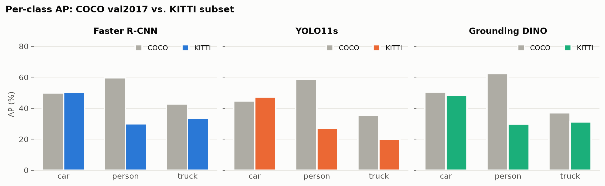
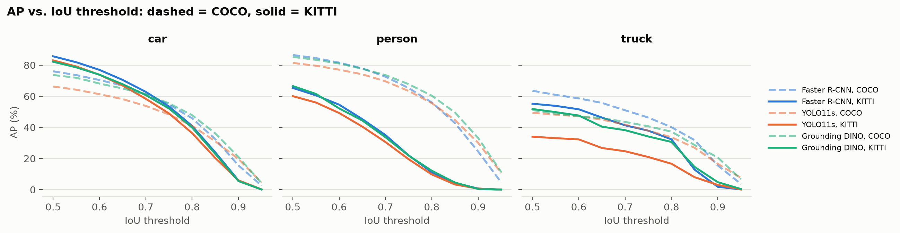
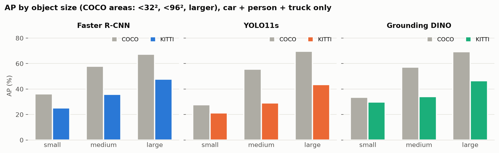
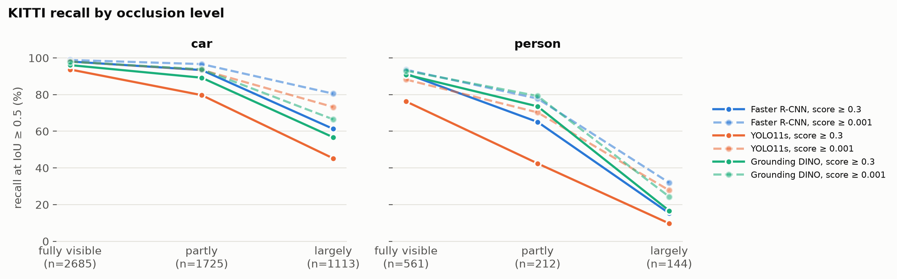
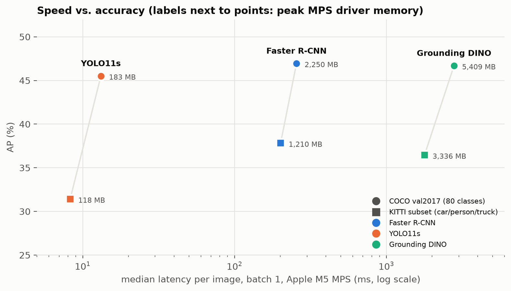
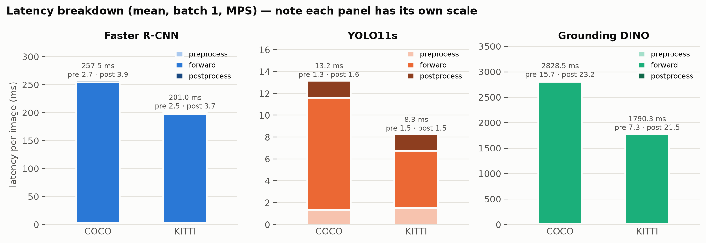
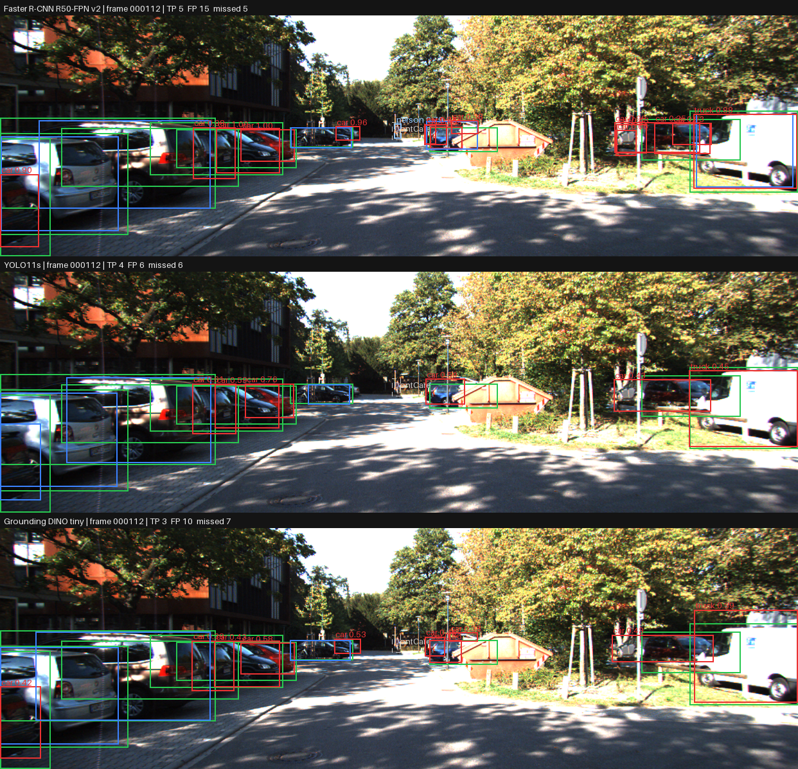
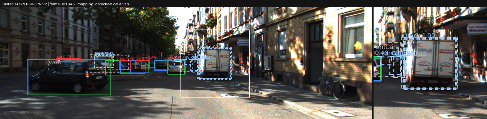
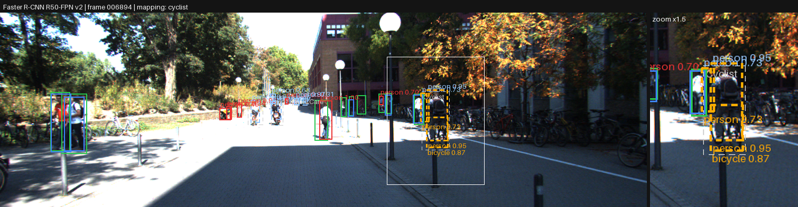
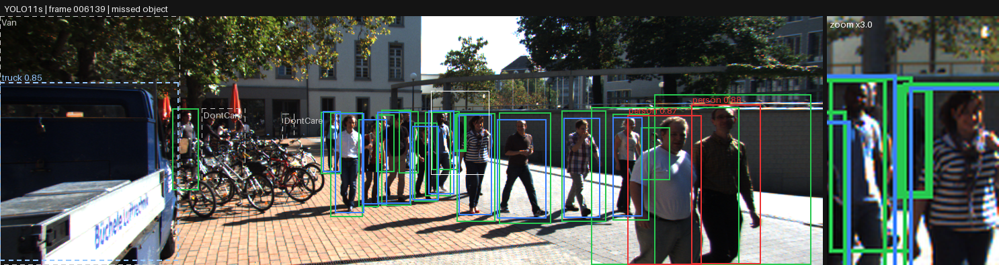

# From Everyday Photos to Street Scenes: Transfer, Speed and Vocabulary of Three COCO-Pretrained Object Detectors

TODO(user): author, course (CMPE 249, Intelligent Autonomous Systems), date.

> **How to use this draft.** It is a skeleton. Tables and figures are filled in from the generated
> results; the prose marked `TODO(user)` is yours to write. Edit `report/report_template.md` and run
> `python -m src.analysis.build_report` to regenerate `report/report_draft.md`. Every number in a table
> comes from a `metrics.json` or `benchmark.json` under `results/` (via `report/tables/`). Target length
> is 6–10 pages as PDF, so not every table below needs to stay. Move the detailed ones to an appendix.

## 1. Introduction: Do Detectors Trained on Everyday Photos Work on a Driving Benchmark?

TODO(user): motivation, 1 paragraph. Why an autonomous system would reuse a pretrained detector instead
of training its own, and why that is risky. Keep the first and last sentence of each paragraph your own
claim, and put citations in the middle sentences (IEEE style, e.g. [1], [2]).

Objectives of this study:

1. Evaluate three pretrained detectors from three design families on the Common Objects in Context
   (COCO) validation set and on a subset of the KITTI (Karlsruhe Institute of Technology and Toyota
   Technological Institute) driving benchmark, without any retraining.
2. Measure how much accuracy each detector loses when moving from COCO to KITTI, and why
   (classes, object size, occlusion, label policy).
3. Measure the speed–accuracy tradeoff on one consumer device (Apple M5) with its graphics processing
   unit (GPU).
4. (Bonus) Test whether an open-vocabulary detector can use KITTI's own class names to close part of
   the gap, and what it can detect that the closed-set models cannot.

TODO(user): one sentence on the paper's structure (sections 2–11).

## 2. Three Detector Families and Two Benchmarks

### 2.1 Detectors

The three detectors are Faster R-CNN (region-based convolutional neural network), YOLO11s (You Only
Look Once, version 11, small) and Grounding DINO tiny (DINO: DETR with improved denoising anchor boxes).

| | Faster R-CNN R50-FPN v2 | YOLO11s | Grounding DINO tiny |
|---|---|---|---|
| Family | two-stage, anchor-based | one-stage, anchor-free | open-vocabulary, query-based transformer |
| Checkpoint | torchvision `fasterrcnn_resnet50_fpn_v2`, `COCO_V1` | Ultralytics `yolo11s.pt` | Hugging Face `IDEA-Research/grounding-dino-tiny` |
| Parameters | 43.7 M | 9.5 M | 172.3 M |
| Input (this study) | short side 800, long side ≤ 1333 | long side 640, letterboxed | short side 800, long side ≤ 1333 |
| Classes | 80 COCO (fixed) | 80 COCO (fixed) | any text prompt |

Parameter counts were measured on the loaded models (`results/analysis/speed_accuracy.json`).

TODO(user): rewrite these three method summaries in your own words; they are placeholders.

The two-stage detector separates *where* from *what*. A region proposal network (RPN) scores
preset anchor boxes on a ResNet-50 feature pyramid network (FPN) and keeps about a thousand candidate
regions, which a second head then classifies and refines [3], [4]. The torchvision v2 weights use an
improved training recipe for the same architecture [5], [11]. Proposal quality is therefore the
first thing a domain shift can break.

The one-stage detector predicts boxes and class scores for every grid cell in a single pass, with no
proposal step. Modern YOLO variants are anchor-free and regress the distances to the four box edges
directly [6], [7]. This design trades a little accuracy for a very short pipeline.

The open-vocabulary detector receives the image and a text prompt such as `car . person . truck .`.
A Swin Transformer image backbone and a Bidirectional Encoder Representations from Transformers
(BERT) text encoder are fused, and a transformer decoder with
900 learned queries predicts boxes, each scored against every prompt word [8], [10], [14]. The checkpoint is loaded through the Hugging Face Transformers library [12], and its
detection head follows the set-prediction approach of the DEtection TRansformer (DETR) [9]. The class list is thus an input,
not a property of the weights.

### 2.2 Datasets and the KITTI label mapping

- **COCO val2017** [1]: 5,000 images, 80 classes, scored on all 80.
- **KITTI 2D object detection** [2]: a fixed random subset of 1,500 frames from the labeled training
  split (seed 42; the list is `data/kitti/subset_1500.txt`). The KITTI test labels are private.
  Scored on car, person and truck, using COCO's own category ids.

| KITTI type | Mapped to | Reason |
|---|---|---|
| Car | car | same class |
| Pedestrian, Person_sitting | person | COCO has one person class |
| Truck | truck | same class |
| Van | ignore (sensitivity test: car) | COCO has no van class; COCO models call vans car or truck |
| Cyclist | ignore (sensitivity test: person) | COCO splits a cyclist into person + bicycle |
| Tram, Misc, DontCare | ignore | no COCO equivalent / unlabelled regions |

An *ignore* box is written as a COCO crowd region (`iscrowd=1`). A detection inside it is neither a
true nor a false positive, and missing it costs nothing. TODO(user): justify this policy in your own
words; section 6.5 shows how much it matters.

{{include: /results/kitti_stats.md}}

## 3. Experimental Setup on Apple Silicon

- **Hardware and software:** see the environment record below (generated by `scripts/record_env.py`).
  All models ran on the GPU through PyTorch's Metal Performance Shaders (MPS) backend, with no CPU
  fallback needed.
- **Evaluation:** one evaluator for everything, pycocotools `COCOeval` (bounding boxes) [13]. It
  reports average precision (AP) averaged over intersection over union (IoU) thresholds 0.50–0.95 (AP50 and AP75 at a single
  threshold; APs/APm/APl by object size), with
  score threshold 0.001 and at most 100 detections per image. On KITTI, every model is asked for all
  80 COCO classes, and predictions outside car/person/truck are dropped afterwards.
- **Model settings** (`configs/models.yaml`):
  - YOLO11s: non-maximum suppression (NMS) at IoU 0.7, one class per box.
  - Grounding DINO: box threshold 0.05; the 80 class names are split into 4 prompts of 20, and the
    chunks are merged with class-wise NMS at IoU 0.5. A box's class comes from its mean probability
    over the tokens of each class name.
- **Speed:** batch 1, 20 warm-up and 200 timed images (the same list for every model), repeated twice.
  Preprocessing, the forward pass and postprocessing are timed separately, with a device synchronize
  before each timestamp.

{{include: /env.txt}}

TODO(user): note anything about the setup a reader needs in order to trust the numbers.

## 4. Commands and Configurations

Everything is reproducible from the repository (`README.md` lists the steps in order); every command
that was run is in `logs/commands.log`.

| Step | Command | Produces |
|---|---|---|
| Environment + COCO | `scripts/m0_setup.sh` | `.venv`, `env.txt`, `data/coco/` |
| KITTI ground truth | `scripts/m2_kitti.sh` | `data/kitti/annotations/kitti_subset_coco.json` |
| Pipeline check | `scripts/m3_eval.sh` | 200-image runs, YOLO cross-check |
| Full evaluation | `scripts/m4_full_runs.sh` | `results/<model>_<dataset>/metrics.json` |
| Speed benchmark | `scripts/m5_benchmark.sh` | `results/benchmark/*/benchmark.json` |
| Analyses 1–2 | `python -m src.analysis.generalization`, `speed_accuracy`, `plots` | tables, figures |
| Analysis 3 + ablations | `scripts/m8_open_vocab.sh` | open-vocabulary tables |
| Failure analysis | `python -m src.analysis.failures` | gallery, counts |
| This draft | `python -m src.analysis.build_report` | `report/report_draft.md` |

## 5. Results on COCO and KITTI

{{include: tables/main_results.md}}

**Sanity checks.** COCO AP is within 1.7 points of the published value for each checkpoint:

{{include: tables/published_check.md}}

YOLO11s through our pipeline is within 0.7 AP of Ultralytics' own validator. Most of the remaining
gap to pycocotools scoring Ultralytics' predictions is the validator's multi-label NMS:

{{include: /results/yolo_crosscheck/crosscheck.md}}

{{include: tables/per_class_kitti.md}}

TODO(user): 2–3 sentences reading the main table.

## 6. Analysis 1: What Breaks When Moving from COCO to KITTI

Detailed write-up with all hypotheses: [analysis_generalization.md](analysis_generalization.md).

### 6.1 Per-class transfer

### 6.2 Localization at high IoU

### 6.3 Object size (shared classes only)

{{include: tables/generalization_size.md}}

### 6.4 Occlusion and truncation

{{include: tables/generalization_occlusion.md}}

### 6.5 Label-policy sensitivity

{{include: tables/generalization_label_policy.md}}

TODO(user): your interpretation. Candidate hypotheses (from `analysis_generalization.md`, not yet
verified): pedestrian box convention, cars already in distribution, van ambiguity, occlusion and
score calibration, small-object robustness of Grounding DINO.

## 7. Analysis 2: The Speed–Accuracy Tradeoff

Detailed write-up: [analysis_speed.md](analysis_speed.md).

{{include: tables/speed_accuracy.md}}

{{include: tables/speed.md}}

### 7.1 Ablations: input size and prompt chunking

The main tables keep the planned settings. These two runs test the M7 hypotheses and are reported as
ablations (the Grounding DINO main results keep 4 prompt chunks).

{{include: tables/followup_experiments.md}}

TODO(user): your interpretation: the cost of open-vocabulary flexibility, and the effect of Faster
R-CNN's 800-pixel input vs. YOLO's 640 letterbox.

## 8. Analysis 3 (Bonus): Closed-Set vs. Open-Vocabulary Detection

Detailed write-up: [analysis_open_vocab.md](analysis_open_vocab.md).

{{include: tables/open_vocab.md}}

TODO(user): your interpretation. Note: the prompt wording was compared on the evaluation data itself
(there is no held-out split); say how you report this fairly.

## 9. Failure Analysis

All 13 cases with descriptions: [failure_cases.md](failure_cases.md).

{{include: tables/failure_counts.md}}

Selected examples (legend: green = ground truth, gray dashed = ignore region, blue = correct
detection, red = false positive or duplicate, light-blue dashed = detection inside an ignore region):

TODO(user): refine the per-image hypotheses in `failure_cases.md` and summarize the main failure modes
here.

## 10. Limitations

TODO(user): turn these into prose and add your own.

- **No fine-tuning.** All results are zero-shot transfer of COCO-pretrained weights. A short
  fine-tune on KITTI would likely change the ranking.
- **MPS timings are not NVIDIA CUDA timings.** Apple's unified memory is shared with the CPU. MPS also
  compiles kernels the first time it sees each input shape (141 vs. 13.5 ms per image for YOLO11s on
  COCO; `results/benchmark/shape_effect.json`). The latency ratios between models may differ on an NVIDIA GPU.
- **KITTI subset size.** 1,500 frames, with only 199 truck boxes, so truck AP is noisy.
- **Grounding DINO setup.**
  - Classes are assigned by token-span scoring, not the plan's original phrase-matching rule; the
    choice is documented in `src/models/grounding_dino.py`.
  - The main results use 4 prompt chunks, which the ablation shows is slower and slightly less
    accurate than one prompt.
  - Prompt wording was compared on the test data.
- **Ignore-region policy.** Van and Cyclist results depend on the mapping (section 6.5), and KITTI's
  own labels are not always consistent with COCO's class names (e.g. a box truck labelled Van).
- **Shared detection cap.** The 100-detection cap is applied over all 80 classes before dropping
  non-KITTI classes. This may cost recall on KITTI, especially for Grounding DINO.
- **YOLO11s NMS.** It keeps one class per box (deployment default), which is about 0.6 AP below
  Ultralytics' validator setting (`results/yolo_crosscheck/summary.json`).

## 11. Conclusions

TODO(user): write your conclusions. Questions the results let you answer, with no answers given here:

- Which model would you deploy for a real-time driving use case on this hardware, and why?
- Is the COCO → KITTI drop mainly a model problem or a dataset-definition problem (box conventions,
  class definitions)? Which evidence supports your answer?
- When is open-vocabulary flexibility worth roughly 50–200× the latency of YOLO11s?
- What would you test next (fine-tuning, larger input for YOLO, a single Grounding DINO prompt,
  CUDA timings)?

## 12. References

TODO(user): check every entry (authors, venue, pages) against the original before submitting.

[1] T.-Y. Lin, M. Maire, S. Belongie, J. Hays, P. Perona, D. Ramanan, P. Dollár, and C. L. Zitnick, "Microsoft COCO: Common objects in context," in *Proc. Eur. Conf. Comput. Vis. (ECCV)*, 2014, pp. 740–755.

[2] A. Geiger, P. Lenz, and R. Urtasun, "Are we ready for autonomous driving? The KITTI vision benchmark suite," in *Proc. IEEE Conf. Comput. Vis. Pattern Recognit. (CVPR)*, 2012, pp. 3354–3361.

[3] S. Ren, K. He, R. Girshick, and J. Sun, "Faster R-CNN: Towards real-time object detection with region proposal networks," in *Proc. Adv. Neural Inf. Process. Syst. (NeurIPS)*, 2015, pp. 91–99.

[4] T.-Y. Lin, P. Dollár, R. Girshick, K. He, B. Hariharan, and S. Belongie, "Feature pyramid networks for object detection," in *Proc. IEEE Conf. Comput. Vis. Pattern Recognit. (CVPR)*, 2017, pp. 2117–2125.

[5] Y. Li, S. Xie, X. Chen, P. Dollár, K. He, and R. Girshick, "Benchmarking detection transfer learning with vision transformers," arXiv:2111.11429, 2021.

[6] J. Redmon, S. Divvala, R. Girshick, and A. Farhadi, "You only look once: Unified, real-time object detection," in *Proc. IEEE Conf. Comput. Vis. Pattern Recognit. (CVPR)*, 2016, pp. 779–788.

[7] G. Jocher and J. Qiu, "Ultralytics YOLO11," 2024. [Online]. Available: https://github.com/ultralytics/ultralytics (model documentation: https://docs.ultralytics.com/models/yolo11/)

[8] S. Liu, Z. Zeng, T. Ren, F. Li, H. Zhang, J. Yang, C. Li, J. Yang, H. Su, J. Zhu, and L. Zhang, "Grounding DINO: Marrying DINO with grounded pre-training for open-set object detection," in *Proc. Eur. Conf. Comput. Vis. (ECCV)*, 2024. arXiv:2303.05499. Model zoo: https://github.com/IDEA-Research/GroundingDINO

[9] N. Carion, F. Massa, G. Synnaeve, N. Usunier, A. Kirillov, and S. Zagoruyko, "End-to-end object detection with transformers," in *Proc. Eur. Conf. Comput. Vis. (ECCV)*, 2020, pp. 213–229.

[10] J. Devlin, M.-W. Chang, K. Lee, and K. Toutanova, "BERT: Pre-training of deep bidirectional transformers for language understanding," in *Proc. Conf. North Amer. Chapter Assoc. Comput. Linguistics (NAACL-HLT)*, 2019, pp. 4171–4186.

[11] TorchVision maintainers and contributors, "TorchVision: PyTorch's computer vision library," 2016. [Online]. Available: https://github.com/pytorch/vision

[12] T. Wolf *et al.*, "Transformers: State-of-the-art natural language processing," in *Proc. Conf. Empirical Methods Natural Lang. Process.: Syst. Demonstrations (EMNLP)*, 2020, pp. 38–45.

[13] COCO Consortium, "COCO API (pycocotools)," [Online]. Available: https://github.com/cocodataset/cocoapi

[14] Z. Liu, Y. Lin, Y. Cao, H. Hu, Y. Wei, Z. Zhang, S. Lin, and B. Guo, "Swin Transformer: Hierarchical vision transformer using shifted windows," in *Proc. IEEE/CVF Int. Conf. Comput. Vis. (ICCV)*, 2021, pp. 10012–10022.
